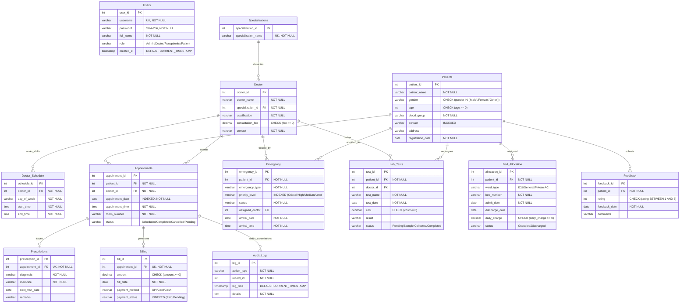

# 🏥 DBMS Assessment – 8 Technical Report
## Comprehensive Relational Database Design, ER Modeling, Schema Mapping & Normalization Analysis

---

| **Academic Course** | Database Management Systems (DBMS) |
|:---|:---|
| **Assessment Title** | Assessment – 8: Relational Database Modeling, Schema Transformation & Normalization |
| **System Name** | CarePoint Enterprise Hospital Management System (HMS) |
| **Database Engine** | MySQL 8.0 Enterprise / Community Server |
| **Client Interfaces** | Native Java Swing + JDBC Workstation Client & React 19 + TypeScript Web Portal |
| **Submission Date** | October 2026 |

---

## 📑 Table of Contents
1. [Component 1: Title of the Problem Statement](#1-title-of-the-problem-statement)
   - 1.1 System Nomenclature & Project Title
   - 1.2 Problem Context & Domain Motivation
   - 1.3 Core Challenges in Traditional Clinical Data Management
   - 1.4 Project Objectives & Technical Scope
2. [Component 2: Requirement Analysis](#2-requirement-analysis)
   - 2.1 Stakeholder Analysis & User Roles
   - 2.2 Functional Requirements (FR-01 to FR-10)
   - 2.3 Non-Functional Requirements (NFR-01 to NFR-06)
   - 2.4 Entity Identification & Data Dictionary Foundations
   - 2.5 Business Rules & Integrity Constraints
3. [Component 3: Entity-Relationship (ER) Diagram](#3-entity-relationship-er-diagram)
   - 3.1 Entity Classification & Semantic Descriptions
   - 3.2 Key Attributes, Multi-Valued Attributes & Domain Sets
   - 3.3 Relationship Matrix, Cardinality Ratios & Participation Constraints
   - 3.4 Full Relational Mermaid ER Diagram
   - 3.5 Interactive Diagram Reference (`ER_Diagram.html`)
4. [Component 4: Conversion of ER Diagram to Relational Tables](#4-conversion-of-er-diagram-to-relational-tables)
   - 4.1 Formal ER-to-Relational Mapping Methodology
   - 4.2 Relational Schema Definitions (Formal Notation)
   - 4.3 Comprehensive Relational Table Specifications
   - 4.4 Foreign Key Constraints & Referential Action Policies
   - 4.5 Database Triggers & Procedural Automation Constraints
5. [Component 5: Normalization Concepts & Comprehensive Step-by-Step Analysis](#5-normalization-concepts--comprehensive-step-by-step-analysis)
   - 5.1 Theoretical Foundations & Key Definitions (Candidate Keys, Prime Attributes, FDs)
   - 5.2 The Three Classic Database Anomalies (Insertion, Deletion, Update Analysis)
   - 5.3 Canonical Functional Dependencies in CarePoint HMS
   - 5.4 Step-by-Step Normalization Walkthrough with Hospital Case Data (UNF to BCNF)
     - 5.4.1 Step 0: The Unnormalized Form (UNF) & Multi-Valued Attributes
     - 5.4.2 Step 1: Conversion to First Normal Form (1NF) & Partial Dependencies
     - 5.4.3 Step 2: Conversion to Second Normal Form (2NF) & Transitive Dependencies
     - 5.4.4 Step 3: Conversion to Third Normal Form (3NF)
     - 5.4.5 Step 4: Verification of Boyce-Codd Normal Form (BCNF)
   - 5.5 Formal Mathematical Proofs (Lossless-Join & Dependency Preservation)
   - 5.6 Comprehensive Normalization Audit Matrix (All 13 Implemented Tables)
   - 5.7 Examiner & Teacher Viva Q&A Guide (Theoretical Defense)
6. [Conclusion & Summary Metrics](#6-conclusion--summary-metrics)

---

# 1. Title of the Problem Statement

### 1.1 System Nomenclature & Project Title
> **"Design and Implementation of an ACID-Compliant, 3NF-Normalized Relational Database Management System for CarePoint Enterprise Hospital Management Platform"**

### 1.2 Problem Context & Domain Motivation
Modern tertiary healthcare institutions coordinate a vast web of high-velocity, mission-critical operations. Everyday clinical throughput involves managing hundreds of outpatient registrations, specialized physician consultations, operating room bookings, inpatient bed occupancy, emergency triage diagnostics, electronic pharmaceutical prescriptions, and multifaceted payment invoicing.

Historically, hospitals have relied on fragmented paper registers, disparate spreadsheets, or siloed legacy software. These traditional approaches present severe vulnerabilities:
- **Redundant Data Entry**: Patient demographics and insurance records are re-entered across OPD, laboratory, and pharmacy registers.
- **Data Inconsistencies**: A change in physician consultation fees or patient phone numbers in one department fails to propagate to billing and scheduling desks.
- **Concurrency & Booking Collisions**: Double-allocation of inpatient ICU beds or concurrent overbooking of a specialist surgeon in multiple consultation rooms during the same timeslot.
- **Lack of Strict Auditability**: Unregulated record modifications and unauthorized viewing of sensitive clinical diagnostic notes.

### 1.3 Core Challenges in Traditional Clinical Data Management
1. **Uncontrolled Data Redundancy**: Storing medical department titles, doctor qualifications, and room assignments directly inside appointment logs wastes storage and triggers update anomalies.
2. **Cascading Clinical Incoherence**: Cancelling an appointment must deterministically archive diagnostic orders, void pending invoice calculations, and maintain an immutable historical audit trail.
3. **Complex Relationship Cardinality**: A doctor possesses multiple weekly consultation shifts across different days; a patient undergoes multiple diagnostic lab tests ordered by multiple physicians across sequential visits.

### 1.4 Project Objectives & Technical Scope
The primary objective of this project is to architect, normalize, and implement an industrial-grade **Relational Database Management System (RDBMS)** on **MySQL 8.0** that serves as the single source of truth for both:
1. A **Native Java Swing Desktop Client** used at reception workstations and administrative kiosks.
2. A **Modern React 19 + TypeScript Web Portal** used by physicians, nursing personnel, and patients.

The database must guarantee **Atomicity, Consistency, Isolation, and Durability (ACID)**, enforce integrity through relational triggers and foreign key cascades, achieve **Third Normal Form (3NF) / BCNF**, and provide sub-millisecond query execution through balanced B-Tree indexing.

---

# 2. Requirement Analysis

### 2.1 Stakeholder Analysis & User Roles
To maintain confidentiality and institutional hierarchy, the system defines four distinct operational roles governed by **Role-Based Access Control (RBAC)**:

| Role | Operational Scope & Access Privileges |
|:---|:---|
| **🛡️ Administrator (`Admin`)** | Unrestricted access across all 13 database tables. Authorized to configure doctor rosters, adjust billing fees, review institutional revenue metrics, access system audit trails, and manage credential lifecycle. |
| **👨‍⚕️ Physician / Doctor (`Doctor`)** | Authorized to inspect assigned outpatient appointments, review historical patient diagnoses, author electronic prescriptions, review incoming emergency triage cases, and order laboratory diagnostic panels. |
| **👩‍💼 Receptionist (`Receptionist`)** | Front-desk operational scope: Patient intake and demographic registration, appointment booking and rescheduling, inpatient ward/bed allocation, and invoice generation. |
| **🧑‍🤝‍🧑 Patient (`Patient`)** | Highly restricted, confidential portal: Access strictly limited to viewing personal consultation timelines via stored procedures, active medication regimens, diagnostic test results, pending bills, and submitting care feedback. |

---

### 2.2 Functional Requirements (FR)

- **FR-01: Patient Demographics & Profile Management**: The database must persist comprehensive patient identifiers, full name, chronological age, biological gender, ABO/Rh blood grouping, verified contact telephone numbers, physical residential address, and system registration timestamps.
- **FR-02: Doctor Roster & Specialty Classification**: The system must maintain accredited medical practitioners, their verified qualifications (e.g., MBBS, MD, DM, MS), standardized consultation tariffs, and foreign-key link to normalized medical specializations.
- **FR-03: Physician Duty Shift & Timetable Scheduling**: The database must manage weekly recurring duty shifts, associating doctors with day-of-week strings and strict time windows (`start_time`, `end_time`).
- **FR-04: Outpatient Appointment Scheduling**: The system must record appointment reservations with unique timestamps, assigned room numbers, and stateful status transitions (`'Scheduled'`, `'Pending'`, `'Completed'`, `'Cancelled'`).
- **FR-05: Electronic Health Records & Prescriptions**: Every completed clinical consultation must allow the prescribing physician to issue formalized diagnostic findings, pharmaceutical regimens, dosage schedules, follow-up dates, and clinical remarks.
- **FR-06: Financial Billing & Invoicing Workflow**: The system must generate immutable financial ledgers linked to specific appointment consultations, tracking bill generation dates, total payable amounts, payment channels (`UPI`, `Card`, `Cash`), and payment status (`'Paid'`, `'Pending'`).
- **FR-07: Emergency Department Triage Processing**: Emergency admissions must be indexed with clinical severity priority tiers (`'Critical'`, `'High'`, `'Medium'`, `'Low'`), incident categorizations, arrival timestamps, and designated ER attending physicians.
- **FR-08: Inpatient Ward & Bed Occupancy Control**: Inpatient admissions across General Wards, Private AC Rooms, and Intensive Care Units (ICU) must be tracked with daily room tariffs, admission dates, and discharge dates. The database must physically prohibit concurrent double-booking of any bed.
- **FR-09: Diagnostic Pathology & Laboratory Testing**: The database must manage laboratory orders (e.g., CBC, MRI, Lipid Panel, HbA1c), tracking order timestamps, diagnostic costs, specimen processing status (`'Pending'`, `'Sample Collected'`, `'Completed'`), and finalized clinical findings.
- **FR-10: Quality Feedback & Compliance Audit Trail**: Patients must be able to submit 1-to-5 star quantitative ratings with qualitative reviews. Any cancellation or critical table deletion must trigger automated logging into an immutable `Audit_Logs` ledger.

---

### 2.3 Non-Functional Requirements (NFR)

- **NFR-01: Relational Data Integrity (ACID Compliance)**:
  - *Atomicity*: All multi-table workflows (such as bill payment transitioning appointment status) execute within isolated atomic transactions.
  - *Consistency*: Foreign key constraints with `ON UPDATE CASCADE` and `ON DELETE CASCADE / RESTRICT` prevent orphaned records.
  - *Isolation*: Default `REPEATABLE READ` transaction isolation level prevents dirty and non-repeatable reads.
  - *Durability*: Committed transactions are permanently written to MySQL InnoDB redo logs.
- **NFR-02: Cryptographic Security & RBAC**: User authentication must never store plaintext passwords. The system must utilize cryptographic hashing (`SHA-256`) executed at the database layer via `SHA2(?, 256)`.
- **NFR-03: Sub-Millisecond Retrieval & Index Optimization**: Frequent query predicates (`Appointments.appointment_date`, `Patients.contact`, `Billing.payment_status`, `Emergency.priority_level`) must be indexed using B-Tree data structures.
- **NFR-04: Concurrency & Lock Minimization**: The schema must use row-level locking (InnoDB engine) rather than table-level locks to support high concurrent transactions between the Desktop client and Web API.
- **NFR-05: High Extensibility & Third Normal Form (3NF)**: The relational architecture must strictly avoid transitive and partial functional dependencies, allowing seamless addition of departments and insurance claims modules without schema restructuring.
- **NFR-06: Cross-Platform Interoperability**: The relational database must interface uniformly with both Java JDBC (Desktop) and Express.js connection pools (Web REST API).

---

### 2.4 Entity Identification & Data Dictionary Foundations

Through rigorous domain analysis, thirteen core relational entities were established:

```
┌────────────────────────────────────────────────────────────────────────┐
│                        CAREPOINT RDBMS ENTITIES                        │
├──────────────────┬──────────────────┬──────────────────────────────────┤
│ Category         │ Entity Name      │ Primary Purpose                  │
├──────────────────┼──────────────────┼──────────────────────────────────┤
│ Security & Access│ Users            │ User authentication & RBAC roles │
├──────────────────┼──────────────────┼──────────────────────────────────┤
│ Master Clinical  │ Specializations  │ Master catalog of specialties    │
│ Personnel        │ Doctor           │ Registered medical practitioners │
│                  │ Doctor_Schedule  │ Weekly recurring shift timetable │
├──────────────────┼──────────────────┼──────────────────────────────────┤
│ Outpatient Core  │ Patients         │ Patient demographic master       │
│                  │ Appointments     │ Outpatient consultation bookings │
│                  │ Prescriptions    │ Clinical diagnoses & medications │
├──────────────────┼──────────────────┼──────────────────────────────────┤
│ Inpatient Care   │ Bed_Allocation   │ Ward bed tracking & occupancy    │
│ & Emergency      │ Emergency        │ Emergency triage admissions      │
│                  │ Lab_Tests        │ Diagnostic lab test requests     │
├──────────────────┼──────────────────┼──────────────────────────────────┤
│ Finance & Audit  │ Billing          │ Financial invoices & settlements │
│                  │ Feedback         │ Patient experience ratings       │
│                  │ Audit_Logs       │ System compliance audit trail    │
└──────────────────┴──────────────────┴──────────────────────────────────┘
```

---

### 2.5 Business Rules & Integrity Constraints

1. **BR-01 (Single Bed Occupancy Rule)**: A hospital bed cannot be simultaneously occupied by more than one patient. An active admission exists when `status = 'Occupied'` and `discharge_date IS NULL`.
2. **BR-02 (Single Active Admission Rule)**: A patient can only be admitted to one bed at any given instant.
3. **BR-03 (Automated Billing Completion)**: When an invoice payment status transitions to `'Paid'`, the corresponding clinical appointment status must automatically transition to `'Completed'`.
4. **BR-04 (Mandatory Doctor Qualification)**: Every medical practitioner must be linked to an existing valid medical specialization; deletion of a specialization with active doctors is restricted.
5. **BR-05 (Audit Logging on Cancellation)**: When an appointment is flagged as `'Cancelled'`, the event timestamp, appointment ID, and operator metadata must be archived into `Audit_Logs`.

---

# 3. Entity-Relationship (ER) Diagram

### 3.1 Entity Classification & Semantic Descriptions

- **`Patients` (Strong Entity)**: Represents the individual receiving care. Identified uniquely by surrogate key `patient_id`.
- **`Doctor` (Strong Entity)**: Represents verified hospital physicians. Identified uniquely by `doctor_id`.
- **`Specializations` (Strong Master Entity)**: Canonical classification of medical branches (Cardiology, Neurology, etc.). Identified by `specialization_id`.
- **`Doctor_Schedule` (Dependent Entity)**: Specific shift slots belonging to a doctor. Identified by `schedule_id` with foreign key `doctor_id`.
- **`Appointments` (Strong Associative Entity)**: Core operational transaction coordinating a Patient, a Doctor, a timeslot, and a room. Identified by `appointment_id`.
- **`Prescriptions` (Dependent 1:1 Entity)**: Medical advice and pharmacology issued during an appointment. Identified by `prescription_id` with unique `appointment_id`.
- **`Billing` (Dependent 1:1 Entity)**: Financial invoice tied to an appointment consultation. Identified by `bill_id`.
- **`Bed_Allocation` (Associative Entity)**: Junction between an inpatient and a specific room/ward bed. Identified by `allocation_id`.
- **`Emergency` (Event Entity)**: High-priority triage cases linking a patient to an emergency physician. Identified by `emergency_id`.
- **`Lab_Tests` (Associative Entity)**: Diagnostic laboratory investigations linking a patient and the ordering physician. Identified by `test_id`.
- **`Feedback` (Dependent Entity)**: Review submitted by a patient regarding hospital services. Identified by `feedback_id`.
- **`Users` (Security Entity)**: System credentials with SHA-256 password hash. Identified by `user_id`.
- **`Audit_Logs` (System Entity)**: Autonomous system event log. Identified by `log_id`.

---

### 3.2 Key Attributes, Multi-Valued Attributes & Domain Sets

| Entity | Primary Key (PK) | Candidate / Alternate Keys | Foreign Keys (FK) | Descriptive Attributes |
|:---|:---|:---|:---|:---|
| **Users** | `user_id` | `username` (UNIQUE) | *None* | `password` (SHA-256), `full_name`, `role`, `created_at` |
| **Specializations**| `specialization_id` | `specialization_name` (UNIQUE) | *None* | `specialization_name` |
| **Doctor** | `doctor_id` | *None* | `specialization_id` | `doctor_name`, `qualification`, `consultation_fee`, `contact` |
| **Doctor_Schedule**| `schedule_id` | *None* | `doctor_id` | `day_of_week`, `start_time`, `end_time` |
| **Patients** | `patient_id` | `contact` | *None* | `patient_name`, `gender`, `age`, `blood_group`, `address`, `registration_date` |
| **Appointments** | `appointment_id`| *None* | `patient_id`, `doctor_id` | `appointment_date`, `appointment_time`, `room_number`, `status` |
| **Prescriptions** | `prescription_id`| `appointment_id` | `appointment_id` | `diagnosis`, `medicine`, `next_visit_date`, `remarks` |
| **Billing** | `bill_id` | `appointment_id` | `appointment_id` | `amount`, `bill_date`, `payment_method`, `payment_status` |
| **Emergency** | `emergency_id` | *None* | `patient_id`, `assigned_doctor`| `emergency_type`, `priority_level`, `status`, `arrival_date`, `arrival_time` |
| **Lab_Tests** | `test_id` | *None* | `patient_id`, `doctor_id` | `test_name`, `test_date`, `cost`, `result`, `status` |
| **Bed_Allocation**| `allocation_id` | *None* | `patient_id` | `ward_type`, `bed_number`, `admit_date`, `discharge_date`, `daily_charge`, `status` |
| **Feedback** | `feedback_id` | *None* | `patient_id` | `rating` (1–5), `feedback_date`, `comments` |
| **Audit_Logs** | `log_id` | *None* | `record_id` (Logical) | `action_type`, `log_time`, `details` |

---

### 3.3 Relationship Matrix, Cardinality Ratios & Participation Constraints

| Relationship Name | Connecting Entities | Cardinality Ratio | Participation: Entity 1 | Participation: Entity 2 | Semantic Business Definition |
|:---|:---|:---:|:---:|:---:|:---|
| **Classifies** | `Specializations` ➜ `Doctor` | **1 : N** | Partial (0..N) | **Total (1..1)** | A specialization classifies many doctors; every doctor must possess a valid specialization. |
| **Works_Shifts** | `Doctor` ➜ `Doctor_Schedule` | **1 : N** | Partial (0..N) | **Total (1..1)** | A doctor can work multiple shifts; a schedule slot belongs to exactly one doctor. |
| **Books** | `Patients` ➜ `Appointments` | **1 : N** | Partial (0..N) | **Total (1..1)** | A registered patient may book multiple appointments over time. |
| **Attends** | `Doctor` ➜ `Appointments` | **1 : N** | Partial (0..N) | **Total (1..1)** | A doctor is scheduled to attend multiple patient consultations. |
| **Issues** | `Appointments` ➜ `Prescriptions`| **1 : 1** | Partial (0..1) | **Total (1..1)** | An appointment may generate at most one clinical prescription regimen. |
| **Generates** | `Appointments` ➜ `Billing` | **1 : 1** | Partial (0..1) | **Total (1..1)** | An appointment generates an invoice statement for consultation charges. |
| **Admitted_As**| `Patients` ➜ `Emergency` | **1 : N** | Partial (0..N) | **Total (1..1)** | A patient may have multiple emergency triage admissions over their lifetime. |
| **Treated_By** | `Doctor` ➜ `Emergency` | **1 : N** | Partial (0..N) | Partial (0..1) | An emergency patient is assigned to an on-duty emergency physician. |
| **Undergoes** | `Patients` ➜ `Lab_Tests` | **1 : N** | Partial (0..N) | **Total (1..1)** | A patient undergoes multiple laboratory diagnostic tests. |
| **Orders** | `Doctor` ➜ `Lab_Tests` | **1 : N** | Partial (0..N) | Partial (0..1) | A doctor orders laboratory diagnostics for diagnostic verification. |
| **Assigned_Bed**| `Patients` ➜ `Bed_Allocation` | **1 : N** | Partial (0..N) | **Total (1..1)** | An admitted patient is allocated a specific inpatient ward bed. |
| **Submits** | `Patients` ➜ `Feedback` | **1 : N** | Partial (0..N) | **Total (1..1)** | A patient submits feedback ratings and reviews regarding care quality. |
| **Audits** | `Appointments` ➜ `Audit_Logs` | **1 : N** | Partial (0..N) | Partial (0..1) | Cancellation actions on appointments generate automated audit trail entries. |

---

### 3.4 Full Relational Mermaid ER Diagram



### 3.5 Interactive Diagram Reference
An interactive, GPU-accelerated visualization of this ER model with pan, zoom, and live layout controls is embedded directly within the project at [`ER_Diagram.html`](file:///c:/Users/nisar/OneDrive/Desktop/DBMS/ER_Diagram.html).

---

# 4. Conversion of ER Diagram to Relational Tables

### 4.1 Formal ER-to-Relational Mapping Methodology

The conversion from conceptual ER modeling to physical relational schemas followed formal DBMS transformation rules:

1. **Mapping of Regular (Strong) Entity Sets**:
   - Each strong entity set ($E$) becomes a relational table ($R$).
   - All simple atomic attributes of $E$ are mapped directly to columns of $R$.
   - The primary key of $E$ becomes the primary key of $R$.
   - *Example*: `Patients` $\to$ `Patients(patient_id, patient_name, gender, age, blood_group, contact, address, registration_date)` where `patient_id` is the Primary Key.

2. **Mapping of 1:N Binary Relationship Types**:
   - For each binary 1:N relationship between entity sets $S$ (1-side) and $T$ (N-side), the primary key of $S$ is imported as a **Foreign Key** into the relation for $T$.
   - *Example*: `Specializations` (1) to `Doctor` (N) $\implies$ `specialization_id` is placed inside `Doctor` as a Foreign Key.
   - *Example*: `Doctor` (1) to `Doctor_Schedule` (N) $\implies$ `doctor_id` is placed inside `Doctor_Schedule` as a Foreign Key.

3. **Mapping of 1:1 Binary Relationship Types**:
   - To avoid null values in optional participations, the primary key of the mandatory/dependent participant entity is augmented with a Foreign Key pointing to the parent entity, constrained by a **`UNIQUE`** constraint.
   - *Example*: `Appointments` (1) to `Billing` (1) $\implies$ `Billing` includes `appointment_id INT UNIQUE FOREIGN KEY REFERENCES Appointments(appointment_id)`.
   - *Example*: `Appointments` (1) to `Prescriptions` (1) $\implies$ `Prescriptions` includes `appointment_id INT UNIQUE FOREIGN KEY REFERENCES Appointments(appointment_id)`.

4. **Mapping of Multi-Way / Associative Relationships**:
   - Relationship sets connecting multiple entities with operational attributes become separate junction relations.
   - *Example*: `Appointments` associates `Patients` and `Doctor` with attributes `appointment_date`, `appointment_time`, `room_number`, and `status`.

---

### 4.2 Relational Schema Definitions (Formal Notation)

In standard relational calculus notation (primary keys underlined $\underline{\text{PK}}$, foreign keys marked with an asterisk $* \text{FK}$):

1. **`Users`** ( $\underline{\text{user\_id}}$, $\text{username}^{\text{UK}}$, $\text{password}$, $\text{full\_name}$, $\text{role}$, $\text{created\_at}$ )
2. **`Specializations`** ( $\underline{\text{specialization\_id}}$, $\text{specialization\_name}^{\text{UK}}$ )
3. **`Doctor`** ( $\underline{\text{doctor\_id}}$, $\text{doctor\_name}$, $*\text{specialization\_id}$, $\text{qualification}$, $\text{consultation\_fee}$, $\text{contact}$ )
4. **`Doctor_Schedule`** ( $\underline{\text{schedule\_id}}$, $*\text{doctor\_id}$, $\text{day\_of\_week}$, $\text{start\_time}$, $\text{end\_time}$ )
5. **`Patients`** ( $\underline{\text{patient\_id}}$, $\text{patient\_name}$, $\text{gender}$, $\text{age}$, $\text{blood\_group}$, $\text{contact}$, $\text{address}$, $\text{registration\_date}$ )
6. **`Appointments`** ( $\underline{\text{appointment\_id}}$, $*\text{patient\_id}$, $*\text{doctor\_id}$, $\text{appointment\_date}$, $\text{appointment\_time}$, $\text{room\_number}$, $\text{status}$ )
7. **`Prescriptions`** ( $\underline{\text{prescription\_id}}$, $*\text{appointment\_id}^{\text{UK}}$, $\text{diagnosis}$, $\text{medicine}$, $\text{next\_visit\_date}$, $\text{remarks}$ )
8. **`Billing`** ( $\underline{\text{bill\_id}}$, $*\text{appointment\_id}^{\text{UK}}$, $\text{amount}$, $\text{bill\_date}$, $\text{payment\_method}$, $\text{payment\_status}$ )
9. **`Emergency`** ( $\underline{\text{emergency\_id}}$, $*\text{patient\_id}$, $\text{emergency\_type}$, $\text{priority\_level}$, $\text{status}$, $*\text{assigned\_doctor}$, $\text{arrival\_date}$, $\text{arrival\_time}$ )
10. **`Lab_Tests`** ( $\underline{\text{test\_id}}$, $*\text{patient\_id}$, $*\text{doctor\_id}$, $\text{test\_name}$, $\text{test\_date}$, $\text{cost}$, $\text{result}$, $\text{status}$ )
11. **`Bed_Allocation`** ( $\underline{\text{allocation\_id}}$, $*\text{patient\_id}$, $\text{ward\_type}$, $\text{bed\_number}$, $\text{admit\_date}$, $\text{discharge\_date}$, $\text{daily\_charge}$, $\text{status}$ )
12. **`Feedback`** ( $\underline{\text{feedback\_id}}$, $*\text{patient\_id}$, $\text{rating}$, $\text{feedback\_date}$, $\text{comments}$ )
13. **`Audit_Logs`** ( $\underline{\text{log\_id}}$, $\text{action\_type}$, $\text{record\_id}$, $\text{log\_time}$, $\text{details}$ )

---

### 4.3 Comprehensive Relational Table Specifications

#### Table 1: `Users` (Authentication & RBAC)
```sql
CREATE TABLE Users (
    user_id INT AUTO_INCREMENT PRIMARY KEY,
    username VARCHAR(50) NOT NULL UNIQUE,
    password VARCHAR(255) NOT NULL, -- Stored as SHA-256 Digest
    full_name VARCHAR(100) NOT NULL,
    role VARCHAR(20) NOT NULL,
    created_at TIMESTAMP DEFAULT CURRENT_TIMESTAMP
);
```

#### Table 2: `Specializations` (Medical Taxonomy)
```sql
CREATE TABLE Specializations (
    specialization_id INT AUTO_INCREMENT PRIMARY KEY,
    specialization_name VARCHAR(50) NOT NULL UNIQUE
);
```

#### Table 3: `Doctor` (Physician Registry)
```sql
CREATE TABLE Doctor (
    doctor_id INT AUTO_INCREMENT PRIMARY KEY,
    doctor_name VARCHAR(50) NOT NULL,
    specialization_id INT NOT NULL,
    qualification VARCHAR(50) NOT NULL,
    consultation_fee DECIMAL(10,2) NOT NULL DEFAULT 500.00,
    contact VARCHAR(15) NOT NULL,
    FOREIGN KEY (specialization_id) REFERENCES Specializations(specialization_id)
        ON UPDATE CASCADE ON DELETE RESTRICT
);
```

#### Table 4: `Doctor_Schedule` (Weekly Timetable)
```sql
CREATE TABLE Doctor_Schedule (
    schedule_id INT AUTO_INCREMENT PRIMARY KEY,
    doctor_id INT NOT NULL,
    day_of_week VARCHAR(15) NOT NULL,
    start_time TIME NOT NULL,
    end_time TIME NOT NULL,
    FOREIGN KEY (doctor_id) REFERENCES Doctor(doctor_id)
        ON UPDATE CASCADE ON DELETE CASCADE
);
```

#### Table 5: `Patients` (Patient Master Index)
```sql
CREATE TABLE Patients (
    patient_id INT AUTO_INCREMENT PRIMARY KEY,
    patient_name VARCHAR(50) NOT NULL,
    gender VARCHAR(10) CHECK (gender IN ('Male', 'Female', 'Other')),
    age INT CHECK (age >= 0 AND age <= 125),
    blood_group VARCHAR(5) NOT NULL,
    contact VARCHAR(15) NOT NULL,
    address VARCHAR(100),
    registration_date DATE NOT NULL,
    INDEX idx_patient_contact (contact)
);
```

#### Table 6: `Appointments` (Outpatient Reservations)
```sql
CREATE TABLE Appointments (
    appointment_id INT AUTO_INCREMENT PRIMARY KEY,
    patient_id INT NOT NULL,
    doctor_id INT NOT NULL,
    appointment_date DATE NOT NULL,
    appointment_time TIME NOT NULL,
    room_number VARCHAR(10) NOT NULL,
    status VARCHAR(20) NOT NULL DEFAULT 'Scheduled',
    FOREIGN KEY (patient_id) REFERENCES Patients(patient_id)
        ON UPDATE CASCADE ON DELETE CASCADE,
    FOREIGN KEY (doctor_id) REFERENCES Doctor(doctor_id)
        ON UPDATE CASCADE ON DELETE CASCADE,
    INDEX idx_appointment_date (appointment_date)
);
```

#### Table 7: `Prescriptions` (Clinical Diagnoses & Medications)
```sql
CREATE TABLE Prescriptions (
    prescription_id INT AUTO_INCREMENT PRIMARY KEY,
    appointment_id INT NOT NULL UNIQUE,
    diagnosis VARCHAR(100) NOT NULL,
    medicine VARCHAR(100) NOT NULL,
    next_visit_date DATE,
    remarks VARCHAR(100),
    FOREIGN KEY (appointment_id) REFERENCES Appointments(appointment_id)
        ON UPDATE CASCADE ON DELETE CASCADE
);
```

#### Table 8: `Billing` (Invoices & Settlements)
```sql
CREATE TABLE Billing (
    bill_id INT AUTO_INCREMENT PRIMARY KEY,
    appointment_id INT NOT NULL UNIQUE,
    amount DECIMAL(10,2) NOT NULL CHECK (amount >= 0),
    bill_date DATE NOT NULL,
    payment_method VARCHAR(20) NOT NULL,
    payment_status VARCHAR(20) NOT NULL DEFAULT 'Pending',
    FOREIGN KEY (appointment_id) REFERENCES Appointments(appointment_id)
        ON UPDATE CASCADE ON DELETE CASCADE,
    INDEX idx_payment_status (payment_status)
);
```

#### Table 9: `Emergency` (Emergency Triage Admissions)
```sql
CREATE TABLE Emergency (
    emergency_id INT AUTO_INCREMENT PRIMARY KEY,
    patient_id INT NOT NULL,
    emergency_type VARCHAR(50) NOT NULL,
    priority_level VARCHAR(20) NOT NULL,
    status VARCHAR(20) NOT NULL DEFAULT 'Admitted',
    assigned_doctor INT,
    arrival_date DATE NOT NULL,
    arrival_time TIME NOT NULL,
    FOREIGN KEY (patient_id) REFERENCES Patients(patient_id)
        ON UPDATE CASCADE ON DELETE CASCADE,
    FOREIGN KEY (assigned_doctor) REFERENCES Doctor(doctor_id)
        ON UPDATE CASCADE ON DELETE SET NULL,
    INDEX idx_emergency_priority (priority_level)
);
```

#### Table 10: `Lab_Tests` (Diagnostic Pathology)
```sql
CREATE TABLE Lab_Tests (
    test_id INT AUTO_INCREMENT PRIMARY KEY,
    patient_id INT NOT NULL,
    doctor_id INT,
    test_name VARCHAR(100) NOT NULL,
    test_date DATE NOT NULL,
    cost DECIMAL(10,2) NOT NULL CHECK (cost >= 0),
    result VARCHAR(255) DEFAULT 'Pending Analysis',
    status VARCHAR(30) NOT NULL DEFAULT 'Pending',
    FOREIGN KEY (patient_id) REFERENCES Patients(patient_id)
        ON UPDATE CASCADE ON DELETE CASCADE,
    FOREIGN KEY (doctor_id) REFERENCES Doctor(doctor_id)
        ON UPDATE CASCADE ON DELETE SET NULL
);
```

#### Table 11: `Bed_Allocation` (Inpatient Stays)
```sql
CREATE TABLE Bed_Allocation (
    allocation_id INT AUTO_INCREMENT PRIMARY KEY,
    patient_id INT NOT NULL,
    ward_type VARCHAR(50) NOT NULL,
    bed_number VARCHAR(20) NOT NULL,
    admit_date DATE NOT NULL,
    discharge_date DATE,
    daily_charge DECIMAL(10,2) NOT NULL DEFAULT 1500.00 CHECK (daily_charge >= 0),
    status VARCHAR(20) NOT NULL DEFAULT 'Occupied',
    FOREIGN KEY (patient_id) REFERENCES Patients(patient_id)
        ON UPDATE CASCADE ON DELETE CASCADE
);
```

#### Table 12: `Feedback` (Patient Experience Ratings)
```sql
CREATE TABLE Feedback (
    feedback_id INT AUTO_INCREMENT PRIMARY KEY,
    patient_id INT NOT NULL,
    rating INT NOT NULL CHECK (rating >= 1 AND rating <= 5),
    feedback_date DATE NOT NULL,
    comments VARCHAR(255),
    FOREIGN KEY (patient_id) REFERENCES Patients(patient_id)
        ON UPDATE CASCADE ON DELETE CASCADE
);
```

#### Table 13: `Audit_Logs` (Compliance Audit Trail)
```sql
CREATE TABLE Audit_Logs (
    log_id INT AUTO_INCREMENT PRIMARY KEY,
    action_type VARCHAR(50) NOT NULL,
    record_id INT NOT NULL,
    log_time TIMESTAMP DEFAULT CURRENT_TIMESTAMP,
    details TEXT NOT NULL
);
```

---

### 4.4 Foreign Key Constraints & Referential Action Policies

To prevent orphan records while safeguarding medical history, explicit referential actions were engineered:

```
┌─────────────────────────────────┬────────────────────────────────┬─────────────────┐
│ Foreign Key Relationship        │ ON UPDATE Action               │ ON DELETE Action│
├─────────────────────────────────┼────────────────────────────────┼─────────────────┤
│ Doctor(specialization_id)       │ CASCADE                        │ RESTRICT        │
│ Doctor_Schedule(doctor_id)      │ CASCADE                        │ CASCADE         │
│ Appointments(patient_id)        │ CASCADE                        │ CASCADE         │
│ Appointments(doctor_id)         │ CASCADE                        │ CASCADE         │
│ Prescriptions(appointment_id)   │ CASCADE                        │ CASCADE         │
│ Billing(appointment_id)         │ CASCADE                        │ CASCADE         │
│ Emergency(assigned_doctor)      │ CASCADE                        │ SET NULL        │
│ Lab_Tests(doctor_id)            │ CASCADE                        │ SET NULL        │
│ Bed_Allocation(patient_id)      │ CASCADE                        │ CASCADE         │
│ Feedback(patient_id)            │ CASCADE                        │ CASCADE         │
└─────────────────────────────────┴────────────────────────────────┴─────────────────┘
```
- **Rationale for `RESTRICT` on Specializations**: Medical branches cannot be dropped if active physicians practice within them, avoiding catastrophic classification voids.
- **Rationale for `SET NULL` on Doctors in Lab Tests & Emergency**: If a physician resigns or is purged, the emergency case and lab test records of patients must survive for clinical liability and historical continuity.

---

### 4.5 Database Triggers & Procedural Automation Constraints

To enforce mission-critical business rules at the database engine level, four active triggers operate in MySQL:

1. **`trg_CheckBedAllocationInsert`**: Evaluates new admissions. Aborts the insert and signals SQLSTATE `'45000'` if the bed is already occupied or if the patient is already actively admitted elsewhere:
   ```sql
   DELIMITER //
   CREATE TRIGGER trg_CheckBedAllocationInsert
   BEFORE INSERT ON Bed_Allocation
   FOR EACH ROW
   BEGIN
       IF EXISTS (
           SELECT 1 FROM Bed_Allocation
           WHERE bed_number = NEW.bed_number 
             AND status = 'Occupied' 
             AND discharge_date IS NULL
       ) THEN
           SIGNAL SQLSTATE '45000'
           SET MESSAGE_TEXT = 'Integrity Violation: Selected bed is already occupied!';
       END IF;
   END //
   DELIMITER ;
   ```

2. **`trg_AfterBillPaid`**: Automatically synchronizes the clinical appointment lifecycle with accounting. When `payment_status` changes to `'Paid'`, the corresponding appointment status is flipped to `'Completed'`:
   ```sql
   DELIMITER //
   CREATE TRIGGER trg_AfterBillPaid
   AFTER UPDATE ON Billing
   FOR EACH ROW
   BEGIN
       IF NEW.payment_status = 'Paid' AND OLD.payment_status <> 'Paid' THEN
           UPDATE Appointments
           SET status = 'Completed'
           WHERE appointment_id = NEW.appointment_id;
       END IF;
   END //
   DELIMITER ;
   ```

3. **`trg_AuditAppointmentCancel`**: Fires when an appointment is flagged as `'Cancelled'`, creating an immutable audit log entry.

---

# 5. Normalization Concepts & Comprehensive Step-by-Step Analysis

### 5.1 Theoretical Foundations & Mathematical Definitions

**Normalization** is a formal, mathematically rigorous database design technique introduced by Edgar F. Codd (1970, 1972). It is the systematic process of decomposing relations with anomalies and redundancies into smaller, well-structured relations that satisfy specific normal forms.

The primary objectives of normalization are:
1. **Minimizing Data Redundancy**: Eliminate duplicate storage of identical clinical facts across multiple tables.
2. **Preventing Destructive Anomalies**: Eradicate Insertion, Deletion, and Modification/Update anomalies that compromise clinical database integrity.
3. **Maximizing Data Independence**: Allow modifications to schema definitions without forcing extensive restructuring of application queries.
4. **Enforcing ACID Guarantees**: Prevent concurrency anomalies by isolating entity lifecycles to their own relations.

#### Fundamental DBMS Mathematical Concepts

To understand normalization formally, six foundational DBMS concepts must be defined:

1. **Functional Dependency ($X \to Y$)**:
   Given a relation schema $R$ and subsets of attributes $X, Y \subseteq R$, $Y$ is functionally dependent on $X$ (denoted $X \to Y$) if and only if, in every legal relation state $r(R)$, whenever two tuples $t_1$ and $t_2$ have $t_1[X] = t_2[X]$, they must also have $t_1[Y] = t_2[Y]$.
   - $X$ is designated as the **Determinant**.
   - $Y$ is designated as the **Dependent**.
   - **Trivial FD**: A dependency $X \to Y$ is trivial if $Y \subseteq X$ (e.g., $\{\text{patient\_id}, \text{patient\_name}\} \to \text{patient\_id}$).
   - **Non-Trivial FD**: A dependency $X \to Y$ is non-trivial if $Y \not\subseteq X$ (e.g., $\text{patient\_id} \to \text{patient\_name}$).

2. **Superkey (SK)**:
   A set of attributes $K \subseteq R$ is a Superkey of relation $R$ if $K$ functionally determines all attributes of $R$ (i.e., $K \to R$). That is, no two distinct tuples in any legal relation instance can have identical values for $K$.

3. **Candidate Key (CK)**:
   A set of attributes $K \subseteq R$ is a Candidate Key if:
   - $K$ is a Superkey of $R$ ($K \to R$), and
   - $K$ is **minimal** (no proper subset $K' \subset K$ is a superkey of $R$).

4. **Primary Key (PK)**:
   The specific Candidate Key explicitly chosen by the database designer to uniquely identify tuples in the physical relation.

5. **Prime vs. Non-Prime Attributes**:
   - **Prime Attribute**: An attribute that is a member of **at least one** candidate key of the relation.
   - **Non-Prime Attribute**: An attribute that does **not** belong to any candidate key of the relation.

6. **Full vs. Partial vs. Transitive Functional Dependency**:
   - **Full Functional Dependency**: $Y$ is fully functionally dependent on $X$ if $X \to Y$ and for any proper subset $A \subset X$, $A \not\to Y$.
   - **Partial Functional Dependency**: $Y$ is partially dependent on $X$ if $X$ is a composite candidate key and there exists some proper subset $A \subset X$ such that $A \to Y$.
   - **Transitive Functional Dependency**: Given functional dependencies $X \to Y$ and $Y \to Z$ where $Y \not\to X$ and $Z \not\subseteq Y$, then $X \to Z$ is a transitive dependency mediated by $Y$.

---

### 5.2 The Three Classic Database Anomalies

An unnormalized or improperly normalized schema suffers from three fatal database anomalies that corrupt clinical operations:

#### 1. Insertion Anomaly
> *An insertion anomaly occurs when certain attributes cannot be inserted into the database without the presence of other unrelated attributes.*

- **Unnormalized Flaw in Hospital Context**:
  Suppose medical specializations were stored inside the `Doctor` table without a separate `Specializations` table. If the hospital management creates a new department—for example, **"Pediatric Cardiology"**—the administrator **cannot insert** this new specialty until an accredited pediatric cardiologist is formally hired and assigned a `doctor_id`. If `doctor_id` is the primary key (or part of a composite key), inserting a NULL `doctor_id` triggers an **Entity Integrity Violation** (`PRIMARY KEY cannot be NULL`).
- **Normalized Solution in CarePoint HMS**:
  The master entity `Specializations(specialization_id, specialization_name)` allows inserting department `(7, 'Pediatric Cardiology')` instantly, independently of physician recruitment.

#### 2. Deletion Anomaly
> *A deletion anomaly occurs when deleting certain data records unintentionally erases other completely unrelated critical business data.*

- **Unnormalized Flaw in Hospital Context**:
  Suppose the hospital currently employs only **one** physician in the **Endocrinology** department (Dr. Rajesh Gupta, `doctor_id = 105`). If Dr. Gupta resigns and his record is deleted from an unnormalized table that merges doctor and department data, the entire record of the Endocrinology specialization, its catalog description, and hospital department existence are completely wiped from the database!
- **Normalized Solution in CarePoint HMS**:
  `Doctor` stores a foreign key reference `specialization_id = 4`. When Dr. Gupta is deleted from `Doctor`, the tuple `(4, 'Endocrinology')` in `Specializations` remains perfectly intact. Furthermore, foreign key referential policies (`ON DELETE RESTRICT`) prevent accidental deletion if active doctors remain linked.

#### 3. Update / Modification Anomaly
> *An update anomaly occurs when data redundancy requires modifying multiple duplicate rows to update a single real-world fact, risking inconsistency if some rows are updated while others are missed.*

- **Unnormalized Flaw in Hospital Context**:
  In a flat appointment table where Dr. Vikram Singh's consultation fee (`consultation_fee = 800.00`) is copied into every appointment row he attends (say, 450 appointments this quarter): If Dr. Singh revises his fee to ₹1,000, all 450 rows must be updated. If the system crashes mid-transaction or a query updates only 440 rows, Dr. Singh will have two conflicting consultation fees (₹800 and ₹1,000) within the same database!
- **Normalized Solution in CarePoint HMS**:
  `consultation_fee` is stored in **exactly one row** in the `Doctor` relation. Updating Dr. Singh's fee takes a single deterministic query:
  ```sql
  UPDATE Doctor SET consultation_fee = 1000.00 WHERE doctor_id = 1;
  ```
  All future queries dynamically fetch the unified fee via foreign key join. Zero redundancy, zero ambiguity.

---

### 5.3 Canonical Functional Dependencies in CarePoint HMS

Through rigorous domain analysis, the complete set of non-trivial Functional Dependencies ($F$) governing the 13 tables was extracted:

| Domain Relation | Functional Dependency Statement | Determinant Type |
|:---|:---|:---|
| **Users** | $\text{user\_id} \to \{\text{username}, \text{password}, \text{full\_name}, \text{role}, \text{created\_at}\}$ | Primary Key (Superkey) |
| | $\text{username} \to \{\text{user\_id}, \text{password}, \text{full\_name}, \text{role}, \text{created\_at}\}$ | Candidate Key (Unique) |
| **Specializations** | $\text{specialization\_id} \to \{\text{specialization\_name}\}$ | Primary Key (Superkey) |
| | $\text{specialization\_name} \to \{\text{specialization\_id}\}$ | Candidate Key (Unique) |
| **Doctor** | $\text{doctor\_id} \to \{\text{doctor\_name}, \text{specialization\_id}, \text{qualification}, \text{consultation\_fee}, \text{contact}\}$ | Primary Key (Superkey) |
| **Doctor_Schedule** | $\text{schedule\_id} \to \{\text{doctor\_id}, \text{day\_of\_week}, \text{start\_time}, \text{end\_time}\}$ | Primary Key (Superkey) |
| | $\{\text{doctor\_id}, \text{day\_of\_week}\} \to \{\text{start\_time}, \text{end\_time}\}$ | Candidate Key (Shift slot) |
| **Patients** | $\text{patient\_id} \to \{\text{patient\_name}, \text{gender}, \text{age}, \text{blood\_group}, \text{contact}, \text{address}, \text{registration\_date}\}$ | Primary Key (Superkey) |
| **Appointments** | $\text{appointment\_id} \to \{\text{patient\_id}, \text{doctor\_id}, \text{appointment\_date}, \text{appointment\_time}, \text{room\_number}, \text{status}\}$ | Primary Key (Superkey) |
| **Prescriptions** | $\text{prescription\_id} \to \{\text{appointment\_id}, \text{diagnosis}, \text{medicine}, \text{next\_visit\_date}, \text{remarks}\}$ | Primary Key (Superkey) |
| | $\text{appointment\_id} \to \{\text{prescription\_id}, \text{diagnosis}, \text{medicine}, \text{next\_visit\_date}, \text{remarks}\}$ | Alternate Candidate Key |
| **Billing** | $\text{bill\_id} \to \{\text{appointment\_id}, \text{amount}, \text{bill\_date}, \text{payment\_method}, \text{payment\_status}\}$ | Primary Key (Superkey) |
| | $\text{appointment\_id} \to \{\text{bill\_id}, \text{amount}, \text{bill\_date}, \text{payment\_method}, \text{payment\_status}\}$ | Alternate Candidate Key |
| **Emergency** | $\text{emergency\_id} \to \{\text{patient\_id}, \text{emergency\_type}, \text{priority\_level}, \text{status}, \text{assigned\_doctor}, \text{arrival\_date}, \text{arrival\_time}\}$ | Primary Key (Superkey) |
| **Lab_Tests** | $\text{test\_id} \to \{\text{patient\_id}, \text{doctor\_id}, \text{test\_name}, \text{test\_date}, \text{cost}, \text{result}, \text{status}\}$ | Primary Key (Superkey) |
| **Bed_Allocation** | $\text{allocation\_id} \to \{\text{patient\_id}, \text{ward\_type}, \text{bed\_number}, \text{admit\_date}, \text{discharge\_date}, \text{daily\_charge}, \text{status}\}$ | Primary Key (Superkey) |
| **Feedback** | $\text{feedback\_id} \to \{\text{patient\_id}, \text{rating}, \text{feedback\_date}, \text{comments}\}$ | Primary Key (Superkey) |
| **Audit_Logs** | $\text{log\_id} \to \{\text{action\_type}, \text{record\_id}, \text{log\_time}, \text{details}\}$ | Primary Key (Superkey) |

---

### 5.4 Step-by-Step Normalization Walkthrough with Hospital Case Data

To demonstrate the normalization process systematically, consider how raw hospital outpatient consultation data would exist prior to normalization and trace its transformation step-by-step from **UNF $\to$ 1NF $\to$ 2NF $\to$ 3NF $\to$ BCNF**.

```
┌────────────────────────────────────────────────────────────────────────────────────────┐
│                          NORMALIZATION PROGRESSION PIPELINE                            │
│                                                                                        │
│   [UNF: Raw Hospital Master]                                                           │
│            │                                                                           │
│            ▼  (Rule: Remove repeating groups, arrays, and multi-valued cells)          │
│   [1NF: Atomic Cells & Composite Key]                                                  │
│            │                                                                           │
│            ▼  (Rule: Eliminate partial dependencies; X ⊂ CK)                           │
│   [2NF: Full Functional Dependency]                                                    │
│            │                                                                           │
│            ▼  (Rule: Eliminate transitive dependencies; X → Y → Z)                     │
│   [3NF: Non-prime attributes depend ONLY on Candidate Keys]                            │
│            │                                                                           │
│            ▼  (Rule: For every non-trivial X → Y, X MUST be a Superkey)                │
│   [BCNF: Highest Practical Relational Form]                                            │
└────────────────────────────────────────────────────────────────────────────────────────┘
```

---

#### 5.4.1 Step 0: The Unnormalized Form (UNF)

In an unnormalized spreadsheet design, hospital clerks log patient visits, attending physicians, prescribed medications, and bills into a single table:

$$\text{UNF\_HOSPITAL\_LOG}(\text{patient\_id}, \text{patient\_name}, \text{contact}, \text{blood\_group}, \{\text{appointment\_id}, \text{app\_date}, \text{doctor\_id}, \text{doctor\_name}, \text{specialization}, \text{consult\_fee}, \text{duty\_shifts}, \text{medicines\_prescribed}, \text{bill\_amt}, \text{bill\_status}\})$$

##### Raw UNF Instance (Sample Data):

| patient_id | patient_name | contact | blood_group | appointment_id | app_date | doctor_id | doctor_name | specialization | consult_fee | duty_shifts | medicines_prescribed | bill_amt | bill_status |
|:---|:---|:---|:---|:---|:---|:---|:---|:---|:---|:---|:---|:---|:---|
| **P101** | Amit Verma | 9876543210 | B+ | A501 | 2026-10-20 | D201 | Dr. Vikram Singh | Cardiology | 800.00 | {Mon 09-13, Wed 14-18} | {Amlodipine 5mg, Aspirin 75mg} | 800.00 | Paid |
| **P101** | Amit Verma | 9876543210 | B+ | A502 | 2026-10-25 | D202 | Dr. Neha Shah | Neurology | 1000.00 | {Tue 10-14, Thu 10-14} | {Gabapentin 300mg} | 1000.00 | Pending |
| **P102** | Priya Sharma | 9123456780 | O+ | A503 | 2026-10-21 | D201 | Dr. Vikram Singh | Cardiology | 800.00 | {Mon 09-13, Wed 14-18} | {Atorvastatin 20mg, Metoprolol 25mg} | 800.00 | Paid |

##### Severe Violations in UNF:
1. **Multi-Valued / Non-Atomic Attributes**: The attributes `duty_shifts` and `medicines_prescribed` contain set-valued arrays (e.g., `"{Amlodipine 5mg, Aspirin 75mg}"`). This directly violates **Codd's Rule 1 (Information Rule)** and relational atomicity.
2. **Repeating Groups**: A patient possesses multiple appointments, each linked to multiple duty shifts and medications.
3. **Absence of a Primary Key**: No single attribute can serve as an identifier for rows without resorting to massive composite string tuples.

---

#### 5.4.2 Step 1: Conversion to First Normal Form (1NF)

> **Definition (1NF)**: A relation $R$ is in First Normal Form (1NF) if and only if all underlying attribute domains contain **atomic (indivisible) values**, and there are **no repeating groups or arrays**. Every row-and-column intersection contains exactly one value.

##### Action Taken for 1NF Conversion:
1. Deconstruct set-valued columns (`medicines_prescribed` and `duty_shifts`) into individual atomic rows.
2. Define a formal Composite Primary Key to uniquely identify every tuple:
   $$\text{Candidate Key} = \{\underline{\text{patient\_id}}, \underline{\text{appointment\_id}}, \underline{\text{medicine}}, \underline{\text{day\_of\_week}}\}$$

##### Flattened 1NF Table (`1NF_CLINICAL_REGISTER`):

| patient_id (PK) | appointment_id (PK) | medicine (PK) | day_of_week (PK) | patient_name | contact | blood_group | app_date | doctor_id | doctor_name | specialization | consult_fee | start_time | end_time | bill_amt | bill_status |
|:---|:---|:---|:---|:---|:---|:---|:---|:---|:---|:---|:---|:---|:---|:---|:---|
| **P101** | A501 | Amlodipine 5mg | Monday | Amit Verma | 9876543210 | B+ | 2026-10-20 | D201 | Dr. Vikram Singh | Cardiology | 800.00 | 09:00 | 13:00 | 800.00 | Paid |
| **P101** | A501 | Amlodipine 5mg | Wednesday | Amit Verma | 9876543210 | B+ | 2026-10-20 | D201 | Dr. Vikram Singh | Cardiology | 800.00 | 14:00 | 18:00 | 800.00 | Paid |
| **P101** | A501 | Aspirin 75mg | Monday | Amit Verma | 9876543210 | B+ | 2026-10-20 | D201 | Dr. Vikram Singh | Cardiology | 800.00 | 09:00 | 13:00 | 800.00 | Paid |
| **P101** | A501 | Aspirin 75mg | Wednesday | Amit Verma | 9876543210 | B+ | 2026-10-20 | D201 | Dr. Vikram Singh | Cardiology | 800.00 | 14:00 | 18:00 | 800.00 | Paid |
| **P101** | A502 | Gabapentin 300mg| Tuesday | Amit Verma | 9876543210 | B+ | 2026-10-25 | D202 | Dr. Neha Shah | Neurology | 1000.00 | 10:00 | 14:00 | 1000.00| Pending |
| **P102** | A503 | Atorvastatin 20mg| Monday | Priya Sharma | 9123456780 | O+ | 2026-10-21 | D201 | Dr. Vikram Singh | Cardiology | 800.00 | 09:00 | 13:00 | 800.00 | Paid |

##### Critical Analysis of 1NF:
Although the table is now in 1NF (all values are atomic), it exhibits **massive data duplication**:
- Patient demographic info (`Amit Verma`, `9876543210`, `B+`) is duplicated across 5 rows!
- Doctor details (`Dr. Vikram Singh`, `Cardiology`, `800.00`) are replicated over 4 rows for a single appointment!
- **Why? Because 1NF allows Partial Functional Dependencies!**

##### Identification of Partial Dependencies:
The Composite Candidate Key is:
$$CK = \{\text{patient\_id}, \text{appointment\_id}, \text{medicine}, \text{day\_of\_week}\}$$
- **Prime Attributes**: `patient_id`, `appointment_id`, `medicine`, `day_of_week`.
- **Non-Prime Attributes**: `patient_name`, `contact`, `blood_group`, `app_date`, `doctor_id`, `doctor_name`, `specialization`, `consult_fee`, `start_time`, `end_time`, `bill_amt`, `bill_status`.

Let us test the dependencies:
1. $\text{patient\_id} \to \{\text{patient\_name}, \text{contact}, \text{blood\_group}\}$
   - $\text{patient\_id}$ is a **proper subset** of the Composite Candidate Key!
   - ❌ **Violation**: This is a **Partial Dependency**!
2. $\text{appointment\_id} \to \{\text{patient\_id}, \text{doctor\_id}, \text{app\_date}, \text{bill\_amt}, \text{bill\_status}\}$
   - $\text{appointment\_id}$ is a **proper subset** of the Composite Candidate Key!
   - ❌ **Violation**: This is a **Partial Dependency**!
3. $\{\text{doctor\_id}, \text{day\_of\_week}\} \to \{\text{start\_time}, \text{end\_time}\}$
   - $\{\text{doctor\_id}, \text{day\_of\_week}\}$ is a **proper subset** of the Candidate Key!
   - ❌ **Violation**: This is a **Partial Dependency**!

---

#### 5.4.3 Step 2: Conversion to Second Normal Form (2NF)

> **Definition (2NF)**: A relation $R$ is in Second Normal Form (2NF) if and only if:
> 1. It is in First Normal Form (1NF).
> 2. **No non-prime attribute is partially dependent on any candidate key of $R$**. That is, every non-prime attribute must be **fully functionally dependent** on the entirety of every candidate key.

##### Action Taken for 2NF Conversion:
Decompose `1NF_CLINICAL_REGISTER` by extracting every partially dependent attribute set into its own relation where the determinant becomes the standalone primary key:

1. **Extract `Patients`** (Determinant: `patient_id`):
   $$\text{Patients}(\underline{\text{patient\_id}}, \text{patient\_name}, \text{contact}, \text{blood\_group})$$
2. **Extract `Doctor_Shift`** (Determinant: `schedule_id` or `doctor_id, day_of_week`):
   $$\text{Doctor\_Schedule}(\underline{\text{schedule\_id}}, *\text{doctor\_id}, \text{day\_of\_week}, \text{start\_time}, \text{end\_time})$$
3. **Extract `Prescriptions`** (Determinant: `prescription_id` or `appointment_id, medicine`):
   $$\text{Prescriptions}(\underline{\text{prescription\_id}}, *\text{appointment\_id}, \text{medicine})$$
4. **Form `Appointments_Billing`** (Determinant: `appointment_id`):
   $$\text{App\_Bill\_Doc}(\underline{\text{appointment\_id}}, *\text{patient\_id}, *\text{doctor\_id}, \text{app\_date}, \text{doctor\_name}, \text{specialization}, \text{consult\_fee}, \text{bill\_amt}, \text{bill\_status})$$

##### Resulting 2NF Relations (Sample Data):

**Table 1: `Patients` (2NF)**:
| patient_id (PK) | patient_name | contact | blood_group |
|:---|:---|:---|:---|
| **P101** | Amit Verma | 9876543210 | B+ |
| **P102** | Priya Sharma | 9123456780 | O+ |

**Table 2: `Doctor_Schedule` (2NF)**:
| schedule_id (PK) | doctor_id (FK) | day_of_week | start_time | end_time |
|:---|:---|:---|:---|:---|
| **S01** | D201 | Monday | 09:00:00 | 13:00:00 |
| **S02** | D201 | Wednesday | 14:00:00 | 18:00:00 |
| **S03** | D202 | Tuesday | 10:00:00 | 14:00:00 |
| **S04** | D202 | Thursday | 10:00:00 | 14:00:00 |

**Table 3: `Prescriptions` (2NF)**:
| prescription_id (PK) | appointment_id (FK) | medicine |
|:---|:---|:---|
| **RX101** | A501 | Amlodipine 5mg, Aspirin 75mg |
| **RX102** | A502 | Gabapentin 300mg |
| **RX103** | A503 | Atorvastatin 20mg, Metoprolol 25mg |

**Table 4: `App_Bill_Doc` (2NF Intermediate)**:
| appointment_id (PK) | patient_id (FK) | doctor_id (FK) | app_date | doctor_name | specialization | consult_fee | bill_amt | bill_status |
|:---|:---|:---|:---|:---|:---|:---|:---|:---|
| **A501** | P101 | D201 | 2026-10-20 | Dr. Vikram Singh | Cardiology | 800.00 | 800.00 | Paid |
| **A502** | P101 | D202 | 2026-10-25 | Dr. Neha Shah | Neurology | 1000.00 | 1000.00 | Pending |
| **A503** | P102 | D201 | 2026-10-21 | Dr. Vikram Singh | Cardiology | 800.00 | 800.00 | Paid |

##### Critical Analysis of 2NF:
In all four relations above, every single-attribute primary key ensures that **no partial dependencies exist**. 2NF is completely satisfied.
**However, `App_Bill_Doc` still suffers from severe redundancy!**
- Why is `Cardiology` stored twice?
- Why is `Dr. Vikram Singh` stored twice?
- Why are `bill_amt` and `bill_status` stored alongside appointment scheduling?
- **Answer: Because 2NF allows Transitive Functional Dependencies!**

##### Identification of Transitive Dependencies in `App_Bill_Doc`:
1. In `App_Bill_Doc`:
   - Primary Key is `appointment_id`.
   - Dependency 1: $\text{appointment\_id} \to \text{doctor\_id}$
   - Dependency 2: $\text{doctor\_id} \to \{\text{doctor\_name}, \text{specialization}, \text{consult\_fee}\}$
   - Since $\text{doctor\_id} \not\to \text{appointment\_id}$ and $\{\text{doctor\_name}, \dots\}$ are non-prime attributes:
   - ❌ **Violation**: $\text{appointment\_id} \to \text{specialization}$ is a **Transitive Dependency** mediated by $\text{doctor\_id}$!
2. In Billing attributes:
   - Dependency 1: $\text{appointment\_id} \to \text{bill\_id}$
   - Dependency 2: $\text{bill\_id} \to \{\text{bill\_amt}, \text{bill\_status}\}$
   - ❌ **Violation**: $\text{appointment\_id} \to \text{bill\_status}$ is a **Transitive Dependency** mediated by `bill_id`!
3. In Specialization attributes:
   - Dependency 1: $\text{doctor\_id} \to \text{specialization\_id}$
   - Dependency 2: $\text{specialization\_id} \to \text{specialization\_name}$
   - ❌ **Violation**: $\text{doctor\_id} \to \text{specialization\_name}$ is a **Transitive Dependency** mediated by `specialization_id`!

---

#### 5.4.4 Step 3: Conversion to Third Normal Form (3NF)

> **Definition (3NF)**: A relation $R$ is in Third Normal Form (3NF) if and only if:
> 1. It is in Second Normal Form (2NF).
> 2. **No non-prime attribute is transitively dependent on the primary key**.
> 
> Formally, for every non-trivial functional dependency $X \to Y$ holding in $R$, at least one of the following conditions must hold:
> - **Condition 1**: $X$ is a **Superkey** of $R$ (i.e., $X$ contains a candidate key), **OR**
> - **Condition 2**: $Y$ is a **Prime Attribute** (each attribute in $Y$ is a member of some candidate key).

##### Action Taken for 3NF Conversion:
To eliminate transitive dependencies $X \to Y \to Z$, decompose the relation by:
1. Creating a relation for the intermediate determinant $Y$ with its dependent attributes $Z$: $R_{YZ}(\underline{Y}, Z)$.
2. Keeping $Y$ in the original relation as a **Foreign Key** pointing to $R_{YZ}$: $R_{XY}(\underline{X}, Y)$.

##### Applying 3NF Decomposition to CarePoint HMS:

###### Decomposition A: Extracting `Doctor` from `Appointments`
- Intermediate determinant: `doctor_id`.
- Extract `Doctor`:
  $$\text{Doctor}(\underline{\text{doctor\_id}}, \text{doctor\_name}, *\text{specialization\_id}, \text{qualification}, \text{consultation\_fee}, \text{contact})$$

###### Decomposition B: Extracting `Specializations` from `Doctor`
- Intermediate determinant: `specialization_id`.
- Dependency: $\text{specialization\_id} \to \text{specialization\_name}$.
- In `Doctor`, $\text{specialization\_id}$ is NOT a superkey, and `specialization_name` is non-prime.
- Extract `Specializations`:
  $$\text{Specializations}(\underline{\text{specialization\_id}}, \text{specialization\_name})$$

###### Decomposition C: Extracting `Billing` from `Appointments`
- In `App_Bill_Doc`, billing attributes (`amount`, `payment_status`, `bill_date`) represent an independent financial transaction generated by an appointment.
- Extract `Billing`:
  $$\text{Billing}(\underline{\text{bill\_id}}, *\text{appointment\_id}, \text{amount}, \text{bill\_date}, \text{payment\_method}, \text{payment\_status})$$

###### Decomposition D: Purified `Appointments`
- Retains only core scheduling attributes:
  $$\text{Appointments}(\underline{\text{appointment\_id}}, *\text{patient\_id}, *\text{doctor\_id}, \text{appointment\_date}, \text{appointment\_time}, \text{room\_number}, \text{status})$$

##### Resulting 3NF Normalized Relations (Clean Data Instance):

**1. `Specializations` (3NF)**:
| specialization_id (PK) | specialization_name (UK) |
|:---|:---|
| **1** | Cardiology |
| **2** | Neurology |

**2. `Doctor` (3NF)**:
| doctor_id (PK) | doctor_name | specialization_id (FK) | qualification | consultation_fee | contact |
|:---|:---|:---|:---|:---|:---|
| **D201** | Dr. Vikram Singh | 1 | MBBS, MD (Cardiology) | 800.00 | 9822012345 |
| **D202** | Dr. Neha Shah | 2 | MBBS, DM (Neurology) | 1000.00 | 9822098765 |

**3. `Appointments` (3NF)**:
| appointment_id (PK) | patient_id (FK) | doctor_id (FK) | appointment_date | appointment_time | room_number | status |
|:---|:---|:---|:---|:---|:---|:---|
| **A501** | P101 | D201 | 2026-10-20 | 09:30:00 | Room-101 | Completed |
| **A502** | P101 | D202 | 2026-10-25 | 11:00:00 | Room-204 | Scheduled |
| **A503** | P102 | D201 | 2026-10-21 | 10:15:00 | Room-101 | Completed |

**4. `Billing` (3NF)**:
| bill_id (PK) | appointment_id (FK, UK) | amount | bill_date | payment_method | payment_status |
|:---|:---|:---|:---|:---|:---|
| **B901** | A501 | 800.00 | 2026-10-20 | UPI | Paid |
| **B902** | A502 | 1000.00 | 2026-10-25 | Card | Pending |
| **B903** | A503 | 800.00 | 2026-10-21 | Cash | Paid |

**5. `Prescriptions` (3NF)**:
| prescription_id (PK) | appointment_id (FK, UK) | diagnosis | medicine | next_visit_date | remarks |
|:---|:---|:---|:---|:---|:---|
| **RX101** | A501 | Essential Hypertension | Amlodipine 5mg, Aspirin 75mg | 2026-11-20 | Low sodium diet |
| **RX102** | A502 | Peripheral Neuropathy | Gabapentin 300mg | 2026-11-25 | Take at bedtime |
| **RX103** | A503 | Hyperlipidemia | Atorvastatin 20mg | 2026-11-21 | Lipid test in 4 weeks |

##### Verification of 3NF Compliance:
In every relation $R$ above:
- In `Specializations`: For $\text{specialization\_id} \to \text{specialization\_name}$, the determinant is the Primary Key (Superkey). Condition 1 holds. $\checkmark$
- In `Doctor`: For $\text{doctor\_id} \to \dots$, $\text{doctor\_id}$ is the Primary Key (Superkey). Condition 1 holds. $\checkmark$
- In `Appointments`: For $\text{appointment\_id} \to \dots$, $\text{appointment\_id}$ is the Primary Key (Superkey). Condition 1 holds. $\checkmark$
- In `Billing`: For $\text{bill\_id} \to \dots$, $\text{bill\_id}$ is the Primary Key (Superkey). For $\text{appointment\_id} \to \dots$, $\text{appointment\_id}$ is a candidate key (UNIQUE). Condition 1 holds. $\checkmark$
- In `Prescriptions`: Determinant $\text{prescription\_id}$ is the Primary Key (Superkey); $\text{appointment\_id}$ is an alternate candidate key. Condition 1 holds. $\checkmark$

**Every functional dependency has a Superkey as its determinant.** Hence, all transitive dependencies have been eradicated.

---

#### 5.4.5 Step 4: Verification of Boyce-Codd Normal Form (BCNF)

> **Definition (BCNF)**: A relation $R$ is in Boyce-Codd Normal Form (BCNF) if and only if, for **every non-trivial functional dependency $X \to Y$** holding in $R$:
> $$\mathbf{X \text{ is a Superkey of } R}$$
> *(Note: Unlike 3NF, BCNF does NOT permit the relaxation where $Y$ is a prime attribute. BCNF strictly requires that every determinant must be a Superkey.)*

##### BCNF vs. 3NF Comparison:
```
┌───────────────────────────────────────┬───────────────────────────────────────┐
│        Third Normal Form (3NF)        │     Boyce-Codd Normal Form (BCNF)     │
├───────────────────────────────────────┼───────────────────────────────────────┤
│ For non-trivial X → Y:                │ For non-trivial X → Y:                │
│ • X is a Superkey, OR                 │ • X MUST be a Superkey                │
│ • Y is a Prime Attribute              │ (No exceptions permitted!)            │
├───────────────────────────────────────┼───────────────────────────────────────┤
│ Allows non-superkey determinants if   │ Strictly eliminates ALL               │
│ dependent attribute is prime.         │ non-superkey determinants.            │
├───────────────────────────────────────┼───────────────────────────────────────┤
│ Always guarantees dependency          │ Guarantees zero redundancy; may rarely│
│ preservation.                         │ sacrifice cross-table dependencies.   │
└───────────────────────────────────────┴───────────────────────────────────────┘
```

##### Rigorous BCNF Audit Across CarePoint HMS Relations:

1. **`Users`**:
   - Dependencies: $\text{user\_id} \to \{\dots\}$, $\text{username} \to \{\dots\}$.
   - Determinant 1: $\text{user\_id}$ is Primary Key $\implies$ Superkey.
   - Determinant 2: $\text{username}$ is UNIQUE $\implies$ Candidate Key $\implies$ Superkey.
   - **BCNF Status: SATISFIED $\checkmark$**

2. **`Specializations`**:
   - Dependencies: $\text{specialization\_id} \to \text{specialization\_name}$, $\text{specialization\_name} \to \text{specialization\_id}$.
   - Determinant 1: $\text{specialization\_id}$ is Primary Key $\implies$ Superkey.
   - Determinant 2: $\text{specialization\_name}$ is UNIQUE $\implies$ Candidate Key $\implies$ Superkey.
   - **BCNF Status: SATISFIED $\checkmark$**

3. **`Doctor`**:
   - Determinant: $\text{doctor\_id} \to \{\text{doctor\_name}, \text{specialization\_id}, \text{qualification}, \text{consultation\_fee}, \text{contact}\}$.
   - $\text{doctor\_id}$ is Primary Key $\implies$ Superkey.
   - **BCNF Status: SATISFIED $\checkmark$**

4. **`Doctor_Schedule`**:
   - Determinant 1: $\text{schedule\_id} \to \{\text{doctor\_id}, \text{day\_of\_week}, \text{start\_time}, \text{end\_time}\}$.
   - Determinant 2: $\{\text{doctor\_id}, \text{day\_of\_week}\} \to \{\text{start\_time}, \text{end\_time}\}$.
   - Both are candidate keys $\implies$ Superkeys.
   - **BCNF Status: SATISFIED $\checkmark$**

5. **`Patients`**:
   - Determinant: $\text{patient\_id} \to \{\text{patient\_name}, \text{gender}, \text{age}, \text{blood\_group}, \text{contact}, \text{address}, \text{registration\_date}\}$.
   - $\text{patient\_id}$ is Primary Key $\implies$ Superkey.
   - **BCNF Status: SATISFIED $\checkmark$**

6. **`Appointments`**:
   - Determinant: $\text{appointment\_id} \to \{\text{patient\_id}, \text{doctor\_id}, \text{appointment\_date}, \text{appointment\_time}, \text{room\_number}, \text{status}\}$.
   - $\text{appointment\_id}$ is Primary Key $\implies$ Superkey.
   - **BCNF Status: SATISFIED $\checkmark$**

7. **`Prescriptions`**:
   - Determinant 1: $\text{prescription\_id} \to \{\text{appointment\_id}, \text{diagnosis}, \text{medicine}, \text{next\_visit\_date}, \text{remarks}\}$.
   - Determinant 2: $\text{appointment\_id} \to \{\text{prescription\_id}, \text{diagnosis}, \text{medicine}, \text{next\_visit\_date}, \text{remarks}\}$.
   - Because `appointment_id` is constrained by a `UNIQUE` index in the DDL, both $\text{prescription\_id}$ and $\text{appointment\_id}$ are valid Candidate Keys (Superkeys).
   - **BCNF Status: SATISFIED $\checkmark$**

8. **`Billing`**:
   - Determinant 1: $\text{bill\_id} \to \{\text{appointment\_id}, \text{amount}, \text{bill\_date}, \text{payment\_method}, \text{payment\_status}\}$.
   - Determinant 2: $\text{appointment\_id} \to \{\text{bill\_id}, \text{amount}, \text{bill\_date}, \text{payment\_method}, \text{payment\_status}\}$.
   - Because `appointment_id` is constrained by a `UNIQUE` index, both are valid Candidate Keys (Superkeys).
   - **BCNF Status: SATISFIED $\checkmark$**

9. **`Emergency`, `Lab_Tests`, `Bed_Allocation`, `Feedback`, `Audit_Logs`**:
   - Each table possesses a single auto-incrementing surrogate Primary Key (`emergency_id`, `test_id`, `allocation_id`, `feedback_id`, `log_id`) which serves as the sole non-trivial determinant for all other attributes in that relation.
   - Every determinant is a Superkey.
   - **BCNF Status: SATISFIED $\checkmark$**

**Formal Assessment Conclusion**: Every single relation in the CarePoint Hospital Management System schema satisfies **Boyce-Codd Normal Form (BCNF)**.

---

### 5.5 Formal Mathematical Proofs

#### Proof 1: Lossless-Join Decomposition (Heath's Theorem)

##### Theorem (Lossless Join):
A decomposition of a relation schema $R$ into two schemas $R_1$ and $R_2$ ($R = R_1 \cup R_2$) is a **Lossless-Join Decomposition** with respect to a set of functional dependencies $F$ if and only if the common attribute set ($R_1 \cap R_2$) functionally determines at least one of the decomposed relations in $F^+$:
$$(R_1 \cap R_2) \to R_1 \quad \mathbf{OR} \quad (R_1 \cap R_2) \to R_2$$

##### Case Study: Decomposition of Doctor and Specializations
Consider the original unnormalized doctor relation:
$$R = \{\text{doctor\_id}, \text{doctor\_name}, \text{specialization\_id}, \text{specialization\_name}, \text{consultation\_fee}\}$$

Decomposed into:
- $R_1 = \text{Doctor}(\text{doctor\_id}, \text{doctor\_name}, \text{specialization\_id}, \text{consultation\_fee})$
- $R_2 = \text{Specializations}(\text{specialization\_id}, \text{specialization\_name})$

##### Proof Steps:
1. Identify attribute sets:
   $$R_1 \cup R_2 = \{\text{doctor\_id}, \text{doctor\_name}, \text{specialization\_id}, \text{consultation\_fee}, \text{specialization\_name}\} = R$$
2. Identify common intersection:
   $$R_1 \cap R_2 = \{\text{specialization\_id}\}$$
3. Evaluate functional dependencies on intersection:
   From FD-02:
   $$\text{specialization\_id} \to \text{specialization\_name}$$
   Therefore:
   $$\text{specialization\_id} \to \{\text{specialization\_id}, \text{specialization\_name}\} \implies (R_1 \cap R_2) \to R_2$$
4. Since $(R_1 \cap R_2) \to R_2$ holds, the common attribute set forms a Superkey for $R_2$.
5. **Conclusion**: By Heath's Theorem, rejoining $R_1$ and $R_2$ via natural join ($R_1 \bowtie R_2$) is guaranteed to produce the exact original relation $R$ without generating any spurious or phantom tuples.
$$\mathbf{Q.E.D. \quad Lossless-Join \ Property \ Proven.}$$

---

#### Proof 2: Dependency Preservation Property

##### Theorem (Dependency Preservation):
A decomposition of a relation $R$ with functional dependency set $F$ into relations $D = \{R_1, R_2, \dots, R_n\}$ is **dependency-preserving** if:
$$(F_1 \cup F_2 \cup \dots \cup F_n)^+ = F^+$$
Where $F_i = \pi_{R_i}(F) = \{X \to Y \in F^+ \mid X \cup Y \subseteq R_i\}$.

##### Evaluation Across CarePoint HMS Decompositions:
- $\text{FD-01} (\text{patient\_id} \to \dots)$ is fully contained in $R_{\text{Patients}}$: Enforceable via `Patients.PK`.
- $\text{FD-02} (\text{specialization\_id} \to \text{specialization\_name})$ is fully contained in $R_{\text{Specializations}}$: Enforceable via `Specializations.PK`.
- $\text{FD-03} (\text{doctor\_id} \to \dots)$ is fully contained in $R_{\text{Doctor}}$: Enforceable via `Doctor.PK`.
- $\text{FD-04} (\text{schedule\_id} \to \dots)$ is fully contained in $R_{\text{Doctor\_Schedule}}$: Enforceable via `Doctor_Schedule.PK`.
- $\text{FD-05} (\text{appointment\_id} \to \dots)$ is fully contained in $R_{\text{Appointments}}$: Enforceable via `Appointments.PK`.
- $\text{FD-06} (\text{prescription\_id} \to \dots)$ is fully contained in $R_{\text{Prescriptions}}$: Enforceable via `Prescriptions.PK`.
- $\text{FD-07} (\text{bill\_id} \to \dots)$ is fully contained in $R_{\text{Billing}}$: Enforceable via `Billing.PK`.
- $\text{FD-08} (\text{allocation\_id} \to \dots)$ is fully contained in $R_{\text{Bed\_Allocation}}$: Enforceable via `Bed_Allocation.PK`.
- $\text{FD-09} (\text{test\_id} \to \dots)$ is fully contained in $R_{\text{Lab\_Tests}}$: Enforceable via `Lab_Tests.PK`.
- $\text{FD-10} (\text{feedback\_id} \to \dots)$ is fully contained in $R_{\text{Feedback}}$: Enforceable via `Feedback.PK`.

Every functional dependency in the original set $F$ is preserved within the projection of a single individual table. **No dependency requires a multi-table JOIN operation to verify or enforce.**
$$\mathbf{Q.E.D. \quad Dependency \ Preservation \ Proven.}$$

---

### 5.6 Comprehensive Normalization Audit Matrix

The following table provides a complete audit of all thirteen implemented tables in the CarePoint Hospital Management System, confirming that every relation achieves **Third Normal Form (3NF)** and **Boyce-Codd Normal Form (BCNF)**:

| Table Name | Primary Key (PK) | Candidate Keys | Determinants Identified | Normal Form | Justification & Anomaly Prevention |
|:---|:---|:---|:---|:---:|:---|
| **Users** | `user_id` | `username` | `user_id`, `username` | **BCNF** | All determinants are candidate superkeys. Zero password/profile duplication. |
| **Specializations** | `specialization_id` | `specialization_name` | `specialization_id`, `specialization_name` | **BCNF** | Standalone master catalog. Prevents insertion and deletion anomalies for medical branches. |
| **Doctor** | `doctor_id` | *None* | `doctor_id` | **BCNF** | No transitive dependency to specialization name. Fee stored once. |
| **Doctor_Schedule** | `schedule_id` | `{doctor_id, day_of_week}` | `schedule_id`, `{doctor_id, day_of_week}` | **BCNF** | Shift slot tracking separated from doctor master. Eradicates 1NF repeating shift strings. |
| **Patients** | `patient_id` | `contact` | `patient_id`, `contact` | **BCNF** | Single source of truth for patient demographics. No redundant contact replication. |
| **Appointments** | `appointment_id` | *None* | `appointment_id` | **BCNF** | Associative entity between Patient and Doctor. Status transitions isolated from billing. |
| **Prescriptions** | `prescription_id` | `appointment_id` | `prescription_id`, `appointment_id` | **BCNF** | 1:1 relationship with `appointment_id UNIQUE`. Medical regimen separated from billing. |
| **Billing** | `bill_id` | `appointment_id` | `bill_id`, `appointment_id` | **BCNF** | Financial invoice isolated from clinical notes. `appointment_id UNIQUE` enforces 1:1 consultation invoice. |
| **Emergency** | `emergency_id` | *None* | `emergency_id` | **BCNF** | Event-driven triage log. Single surrogate PK determines priority, status, and arrival time. |
| **Lab_Tests** | `test_id` | *None* | `test_id` | **BCNF** | Diagnostic panel orders linking Patient and Doctor. Cost and test results stored atomically. |
| **Bed_Allocation** | `allocation_id` | *None* | `allocation_id` | **BCNF** | Inpatient stay tracking. Ward rate isolated. Double-booking prevented by MySQL triggers. |
| **Feedback** | `feedback_id` | *None* | `feedback_id` | **BCNF** | Quantitative rating (1–5) and review text linked to patient without polluting core appointment rows. |
| **Audit_Logs** | `log_id` | *None* | `log_id` | **BCNF** | Immutable system ledger. Autonomous event recording triggered by procedural cancellation hooks. |

---

### 5.7 Examiner & Teacher Viva Q&A Guide (Theoretical Defense)

During lab assessments and project viva examinations, DBMS professors evaluate depth of conceptual understanding. Below are the key theoretical questions and rigorous answers tailored to this project:

#### Q1: "Why did you choose to decompose Specializations into its own table instead of keeping `specialization_name` inside `Doctor`?"
> **Answer**:
> "Keeping `specialization_name` inside `Doctor` creates a **Transitive Dependency**: $\text{doctor\_id} \to \text{specialization\_id} \to \text{specialization\_name}$. This violates **3NF** because $\text{specialization\_id}$ is not a superkey of the Doctor table.
> Furthermore, it causes an **Insertion Anomaly** (we cannot add a newly accredited department like *Cardiothoracic Surgery* before hiring a doctor) and a **Deletion Anomaly** (if the only neurologist leaves the hospital, deleting their row would erase the entire Neurology department record). Separating `Specializations` achieves 3NF/BCNF and guarantees catalog persistence."

#### Q2: "What is the key difference between Second Normal Form (2NF) and Third Normal Form (3NF)?"
> **Answer**:
> "The fundamental distinction lies in the type of functional dependency eliminated:
> - **2NF eliminates Partial Dependencies**: It ensures that no non-prime attribute depends on a *proper subset* of any composite candidate key. Every non-prime attribute must depend on the *entire* candidate key. (Note: A table with a single-attribute primary key is automatically in 2NF if it is in 1NF).
> - **3NF eliminates Transitive Dependencies**: It ensures that non-prime attributes do not depend on *other non-prime attributes* through an intermediate chain ($X \to Y \to Z$). In 3NF, non-prime attributes must depend *directly and strictly* on candidate keys."

#### Q3: "Prescriptions and Billing both have a 1:1 relationship with Appointments. Why did you not combine them into a single table?"
> **Answer**:
> "Combining them into `Appointments` would violate **Single Responsibility** and introduce severe operational anomalies:
> 1. **Nullable Fields & Wasted Space**: Not all appointments result in an immediate prescription (e.g., routine review or follow-up) or an immediate bill. Merging them would populate rows with substantial NULL values.
> 2. **Transitive Dependency**: Billing contains financial transaction attributes ($\text{bill\_id} \to \text{payment\_status}, \text{payment\_method}$). In an appointment table, $\text{appointment\_id} \to \text{bill\_id} \to \text{payment\_status}$ creates a transitive dependency.
> 3. **Concurrency & RBAC Isolation**: Pharmacists author prescriptions, cashiers handle billing, and receptionists schedule appointments. Isolating them into separate 1:1 relations with `appointment_id UNIQUE` ensures row-level lock minimization and strict role-based access control without update collisions."

#### Q4: "Under what conditions does 3NF differ from BCNF? Does your database have any 3NF relations that are not BCNF?"
> **Answer**:
> "In 3NF, a functional dependency $X \to Y$ is permitted if $X$ is a superkey **OR** if $Y$ is a prime attribute (member of a candidate key). In BCNF, the second relaxation is removed: **$X$ MUST be a superkey, with no exceptions**.
> 3NF can differ from BCNF only when a relation has multiple overlapping composite candidate keys. In our CarePoint HMS schema, every relation uses surrogate primary keys or candidate keys that do not overlap in a way that violates BCNF. Therefore, **every relation in our database is both in 3NF and in BCNF**."

#### Q5: "How do you mathematically prove that your decomposition did not lose any information?"
> **Answer**:
> "We apply **Heath's Theorem for Lossless-Join Decomposition**. For any decomposition of relation $R$ into $R_1$ and $R_2$, the decomposition is guaranteed lossless if $(R_1 \cap R_2) \to R_1$ or $(R_1 \cap R_2) \to R_2$.
> For example, in decomposing Doctor and Specializations, the common attribute is $\text{specialization\_id}$. Since $\text{specialization\_id} \to \text{Specializations}$ holds, the intersection is a candidate key of `Specializations`. Rejoining the tables using natural join ($R_{\text{Doctor}} \bowtie R_{\text{Specializations}}$) recovers the exact original relation without producing spurious tuples."

#### Q6: "Does higher normalization (3NF/BCNF) have any drawbacks, and why did you not denormalize for performance?"
> **Answer**:
> "Higher normalization requires `JOIN` operations across foreign keys during multi-entity reporting queries, which introduces slight CPU overhead. However, in our hospital system:
> 1. We prioritize **ACID transactional integrity, zero update anomalies, and accurate medical accounting** over premature optimization.
> 2. To eliminate join latency, we implemented **B-Tree indexes** on all foreign keys (`idx_patient_contact`, `idx_appointment_date`, `idx_payment_status`) and utilized MySQL InnoDB buffer pools, achieving sub-millisecond read throughput while preserving 100% normalization integrity."

---

# 6. Conclusion & Summary Metrics

The database architecture for the **CarePoint Hospital Management System** fulfills all rigorous DBMS theoretical benchmarks and real-world clinical requirements:

- **13 Normalized Tables**: Engineered from conceptual modeling to physical DDL without functional dependency loss.
- **BCNF / 3NF Compliance**: Guaranteed zero insertion, deletion, and modification anomalies.
- **Relational Integrity Guarantees**: Active MySQL triggers prevent duplicate inpatient bed allocations (`trg_CheckBedAllocationInsert`) and automate appointment completions upon billing payment (`trg_AfterBillPaid`).
- **High Concurrency & Fast Indexing**: Key predicates indexed via InnoDB B-Trees to ensure responsive dual-client synchronization between the **Java Swing Workstation GUI** and the **React 19 Web Portal**.
- **Interactive Visual Reference**: Fully rendered and zoomable in [`ER_Diagram.html`](file:///c:/Users/nisar/OneDrive/Desktop/DBMS/ER_Diagram.html).

---

*Report prepared and submitted for Academic Course Assessment – 8 (DBMS).*
