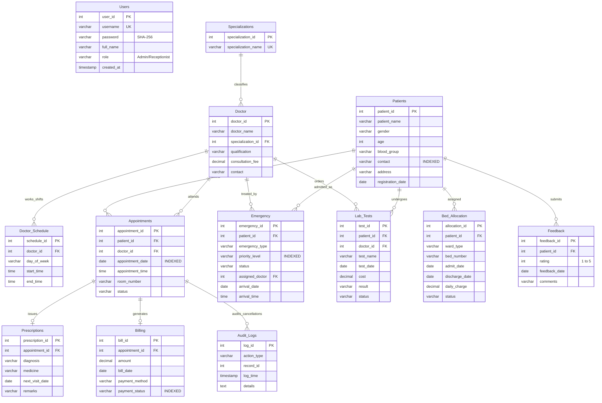

# 🏥 Hospital Management System (HMS)

[](https://github.com/nisargjoshi2006-web/HospitalManagementSystem/actions)
[](https://www.oracle.com/java/)
[](https://react.dev/)
[](https://www.typescriptlang.org/)
[](https://tailwindcss.com/)
[](https://expressjs.com/)
[](https://www.mysql.com/)
[](LICENSE)

> **Enterprise-Grade Dual-Client Healthcare Management Platform**  
> Powered by **React 19 + TypeScript + Tailwind CSS** (Web Client), **Java Swing + JDBC** (Desktop Client), **Node.js & Express** (REST API), and a unified **MySQL 8.0+** Relational Database.


---

## 🌟 Executive Summary

The **Hospital Management System (HMS)** is a dual-client clinical management platform engineered to streamline hospital operations, outpatient departments (OPD), inpatient bed allocation, emergency triage, doctor duty scheduling, diagnostic testing, pharmacy prescriptions, and billing workflows.

The system features **dual frontend interfaces** connected to a single central **MySQL** database with real-time data synchronization, robust ACID guarantees, and strict relational integrity triggers:

1. 🌐 **Modern Web Application (`frontend/`)**: Modern responsive web portal built from Figma UI/UX with interactive charts, live status badges, and an interactive **Doctor Schedule Weekly Timetable Grid**.
2. 🖥️ **Native Desktop Client (`src/ui/`)**: Native Java Swing desktop application designed for administrative workstations, equipped with CSV report exporters and role-based access control.
3. ⚡ **Central REST API Engine (`backend/`)**: High-throughput Express.js REST API with connection pooling, parameterized SQL queries, and complete CRUD endpoints.
4. 🗄️ **Relational Database Engine (`Database.sql`)**: 13 normalized tables, automated triggers, indexed search fields, analytical views, and clinical stored procedures.

---

## 🏗️ System Architecture

```
                                  ┌───────────────────────────────┐
                                  │   👨‍⚕️ Hospital Administrator    │
                                  │   👩‍💼 Receptionist & Staff     │
                                  └───────────────┬───────────────┘
                                                  │
                 ┌────────────────────────────────┴────────────────────────────────┐
                 │                                                                 │
                 ▼                                                                 ▼
   ┌───────────────────────────┐                                     ┌───────────────────────────┐
   │    🌐 Modern Web Client    │                                     │   🖥️ Native Desktop Client │
   │  React 19 + TypeScript    │                                     │       Java Swing + AWT    │
   │   Tailwind CSS v4 + Vite  │                                     │        JDK 17+ / JDBC     │
   │  (Port 5173 / localhost)  │                                     │    (Workstation Native)   │
   └─────────────┬─────────────┘                                     └─────────────┬─────────────┘
                 │ (HTTP / JSON)                                                   │ (JDBC TCP/IP)
                 ▼                                                                 │
   ┌───────────────────────────┐                                                   │
   │    ⚡ REST API Backend    │                                                   │
   │    Node.js + Express.js   │                                                   │
   │  (Port 5000 / localhost)  │                                                   │
   └─────────────┬─────────────┘                                                   │
                 │ (mysql2 pool)                                                   │
                 └────────────────────────────────┬────────────────────────────────┘
                                                  │
                                                  ▼
                               ┌─────────────────────────────────────┐
                               │       🗄️ Central MySQL 8.0+         │
                               │   hospital Database (13 Tables)     │
                               │  Triggers • Views • Stored Procs    │
                               └─────────────────────────────────────┘
```

> **Live Bidirectional Synchronization**: Any record created, modified, or deleted in the **Web Client** is instantly reflected in the **Desktop Client** (and vice-versa), ensuring single-source-of-truth clinical integrity.

---

## 📋 Comprehensive Module Directory

| Module | Web Page | Desktop Tab | Core Capabilities |
| :--- | :--- | :--- | :--- |
| **🔐 Authentication & Portals** | `Login.tsx` | `LoginUI.java` | VTOP-style 4-role portal selector (Doctor, Receptionist, Patient, Admin), SHA-256 hashing, 1-click pre-fill |
| **📊 Live Dashboard** | `Dashboard.tsx` | `DashboardPanel.java` | Real-time KPI cards (Patients, Doctors, Beds, Emergencies, Bills, Revenue) + live clinical feeds |
| **🧑‍⚕️ Patient Health Portal** | `PatientPortal.tsx` | `PatientPortalPanel.java` | Personal consultation timeline via `sp_GetPatientHistory(?)`, prescribed medicines, active diagnoses, billing statuses |
| **🧑‍🤝‍🧑 Patients Master** | `Patients.tsx` | `PatientPanel.java` | Demographics, blood group categorization, instant search, safe cascade deletion |
| **👨‍⚕️ Doctors Directory** | `Doctors.tsx` | `DoctorPanel.java` | Specialty mapping, qualifications, consultation fees, contact directory |
| **📅 Doctor Schedule** | `DoctorSchedule.tsx` | `DoctorSchedulePanel.java` | **Interactive Weekly Timetable Grid**, 7-day Kanban board, quick presets, slot manager |
| **🕒 Appointments** | `Appointments.tsx` | `AppointmentPanel.java` | Date & room booking, doctor availability verification, status workflows |
| **💊 Prescriptions** | `Prescriptions.tsx` | `PrescriptionPanel.java` | Clinical diagnoses, medication regimens, dosage instructions, follow-up scheduling |
| **💳 Billing & Invoices** | `Billing.tsx` | `BillingPanel.java` | Auto-calculated fees, multi-channel payment (UPI/Card/Cash), automated completion trigger |
| **🚨 Emergency Triage** | `Emergency.tsx` | `EmergencyPanel.java` | 4-tier triage (`Critical`, `High`, `Medium`, `Low`), assigned ER physicians, status tracking |
| **🧪 Lab Tests** | `LabTests.tsx` | `LabTestPanel.java` | Diagnostic orders (CBC, MRI, ECG, Lipid Panel, HbA1c), specimen tracking, test results |
| **🛏️ Bed Allocation** | `BedAllocation.tsx` | `BedAllocationPanel.java` | Ward management (ICU, Private AC, General), trigger-enforced single occupancy, discharge |
| **⭐ Patient Feedback** | `Feedback.tsx` | `FeedbackPanel.java` | 1-5 star ratings, qualitative patient reviews, patient experience monitoring |
| **📈 Reports & BI** | `Reports.tsx` | `ReportsPanel.java` | 8 analytical reports, stored procedure patient history viewer, workload analysis, **CSV Export** |
| **🛡️ Audit Logs** | `AuditLogs.tsx` | `AuditLogDAO.java` | Automated logging of appointment cancellations, security compliance trail |

---

## 🛡️ Role-Based Access Control (RBAC) & Multi-Role Portals

The application implements strict **Role-Based Access Control (RBAC)** across both the **Web Client** (`visibleNavItems` sidebar filter) and the **Java Desktop Client** (tailored `JTabbedPane` tabs):

### Role Visibility & Permission Matrix

| System Module | 🛡️ Admin | 👨‍⚕️ Doctor | 👩‍💼 Receptionist | 🧑‍🤝‍🧑 Patient |
| :--- | :---: | :---: | :---: | :---: |
| **🧑‍⚕️ Patient Health Portal** (`sp_GetPatientHistory`) | ❌ | ❌ | ❌ | ✅ |
| **📊 Live Dashboard** | ✅ | ❌ | ✅ | ❌ |
| **🧑‍🤝‍🧑 Patients Master** | ✅ | ✅ | ✅ | ❌ |
| **👨‍⚕️ Doctors Directory** | ✅ | ❌ | ❌ | ❌ |
| **📅 Doctor Schedule & Weekly Timetable** | ✅ | ✅ | ❌ | ❌ |
| **🕒 Appointments Management** | ✅ | ✅ | ✅ | ✅ |
| **💊 Prescriptions & Regimens** | ✅ | ✅ | ❌ | ✅ |
| **💳 Billing & Payments** | ✅ | ❌ | ✅ | ✅ |
| **🚨 Emergency Department Triage** | ✅ | ✅ | ✅ | ❌ |
| **🧪 Diagnostic Lab Tests** | ✅ | ✅ | ✅ | ❌ |
| **🛏️ Bed Allocation & Inpatient Wards** | ✅ | ❌ | ✅ | ❌ |
| **⭐ Patient Care Feedback** | ✅ | ✅ | ✅ | ✅ *(Submit)* |
| **📈 Reports & BI (CSV Export)** | ✅ | ❌ | ❌ | ❌ |
| **🛡️ System Audit Logs** | ✅ | ❌ | ❌ | ❌ |

---

## 🖥️ Java Swing Systematic Typography & Desktop UI Architecture (`UITheme.java`)

The desktop client features an enterprise-grade visual hierarchy engineered via `ui.UITheme`:

1. **Subpixel Font Anti-Aliasing**:
   - Explicitly configured with `awt.useSystemAAFontSettings=on` and `swing.aatext=true` to eliminate jagged Swing typography.
2. **Systematic Font Scale (Segoe UI Native)**:
   - Replaced legacy hardcoded `16pt Arial` with a proportional typographic scale (`11pt` to `22pt`) anchored to native Windows `Segoe UI` (with cross-platform fallbacks).
   - Global `UIManager` font registration automatically harmonizes all tabs, table headers, form inputs, tooltips, and dialogs.
3. **Dual Logout Mechanism**:
   - **Elevated Top App Bar**: High-visibility user identity banner displaying the user's name, role pill, and a prominent red `🚪 Logout` button with hover state transitions and confirmation prompt.
   - **Native System Menu Bar (`JMenuBar`)**: Standard desktop menus (`File -> Logout (Ctrl+L)`, `File -> Exit (Ctrl+Q)`, `Account -> User Info`, `Help -> About HMS`).
4. **Enhanced Table Styling**:
   - Automated alternating row heights (`28px`), styled table headers, and soft selection highlights via `UITheme.styleTable(table)`.
5. **Always-Fresh Launcher (`start_desktop.bat`)**:
   - Automatically recompiles all Java sources with UTF-8 encoding prior to launching, ensuring newly added classes, bug fixes, and RBAC updates are immediately active.

---

## 🔔 Highlight: Real-Time Notification Bell & Reports CSV Export

- **🔔 Notification Bell Popover (`Layout.tsx`)**:
  - Interactive top-header bell icon with dynamic badge counter.
  - Toggles an animated popover presenting live hospital alerts: Critical ER triage admissions, pending lab diagnostics, and new feedback submissions.
- **📥 CSV Export Engine (`Reports.tsx` & `ReportsPanel.java`)**:
  - Instant one-click CSV report export across all 8 analytical views.
  - Interactive Patient History selector backed by MySQL stored procedure `CALL sp_GetPatientHistory(?)`.

---

## 📅 Highlight: Doctor Schedule & Visual Timetable

The Doctor Schedule module (`DoctorSchedule.tsx`) includes a visual weekly timetable system:

1. **Timetable Grid (Matrix View)**:
   - **Rows**: Doctors with avatar initials and color-coded specialization badges (Cardiology, Neurology, Orthopedics, Dermatology, General Medicine).
   - **Columns**: Monday through Sunday (with highlighted weekend coverage).
   - **Cells**: Shift blocks showing shift time ranges (`09:00 - 13:00`), shift tags (*Morning OPD*, *Afternoon OPD*, *Evening OPD*), and quick delete buttons.
   - **Direct Cell Scheduling**: Clicking `+ Add` in any cell pre-fills the doctor and day in the booking modal.
2. **Daily Columns (7-Day Board View)**:
   - Kanban-style column board organizing all duty shifts per day.
3. **Detailed Table List View**:
   - Tabular view for searching, filtering, and administration.
4. **Quick Time Presets**:
   - 🌅 *Morning OPD (09:00 - 13:00)*
   - ☀️ *Afternoon OPD (14:00 - 18:00)*
   - 🌙 *Evening OPD (16:00 - 20:00)*
   - 🏥 *Mid-day Round (10:00 - 14:00)*

---

## ⚡ Advanced Database Management Concepts

### 1. Database Schema (13 Normalized Tables)
- `Users`: Administrative accounts with SHA-256 password digests.
- `Patients`: Patient demographics, blood groups, addresses, and registration dates.
- `Specializations`: Normalized medical specialty master table.
- `Doctor`: Doctor roster with specialization foreign keys and consultation rates.
- `Doctor_Schedule`: Weekly day-wise duty hours and consultation shifts.
- `Appointments`: Consultation reservations with room numbers, dates, times, and statuses.
- `Prescriptions`: Diagnostic notes, medications, next visit dates, and physician instructions.
- `Billing`: Invoices with auto-calculated consultation fees, payment methods, and statuses.
- `Emergency`: Emergency department triage records with priority ratings and assigned doctors.
- `Lab_Tests`: Diagnostic lab orders, costs, specimen status, and clinical results.
- `Bed_Allocation`: Inpatient bed stays across ICU, Private AC, and General Wards.
- `Feedback`: Patient ratings (1–5 stars) and qualitative care feedback.
- `Audit_Logs`: System audit trail recording cancellations and modifications.

#### 🌐 Interactive ER Diagram Explorer
An interactive full-screen Mermaid viewer with zoom, pan, and fit-to-screen controls is included in [`ER_Diagram.html`](ER_Diagram.html).



### 2. Automated Relational Triggers
- **`trg_CheckBedAllocationInsert`**: Enforces strict single occupancy. Throws SQL exception `45000` if a bed is already occupied or if a patient is already admitted.
- **`trg_CheckBedAllocationUpdate`**: Prevents bed allocation collisions during status or room modifications.
- **`trg_AfterBillPaid`**: Automatically transitions the corresponding `Appointments.status` to `'Completed'` when bill payment status changes to `'Paid'`.
- **`trg_AuditAppointmentCancel`**: Automatically logs appointment cancellation events into `Audit_Logs`.

### 3. Analytical Views
- **`v_ActiveAppointments`**: Pre-joined view joining Appointments, Patients, and Doctors for real-time OPD queues.
- **`v_HospitalRevenueSummary`**: Aggregated revenue metrics grouped by payment method (`UPI`, `Card`, `Cash`).

### 4. Stored Procedures
- **`sp_GetPatientHistory(IN p_patient_id INT)`**: Consolidates complete clinical history, prescriptions, diagnostic tests, and billing summaries for any given patient ID.

---

## 🛠️ Technology Stack

| Layer | Technologies |
| :--- | :--- |
| **Web Frontend** | React 19, TypeScript, Tailwind CSS v4, Vite 8, Lucide Icons, Recharts |
| **Web Backend API** | Node.js (v18+), Express.js, `mysql2` (Connection Pool), CORS |
| **Desktop Frontend** | Java 17+, Java Swing, Java AWT |
| **Desktop Data Access** | JDBC (Java Database Connectivity) with PreparedStatements & POJO DAOs |
| **Database** | MySQL 8.0+ Enterprise / Community Server |
| **Security** | SHA-256 Cryptographic Hashing (`SHA2(?, 256)`), Parameterized SQL queries |

---

## 🚀 Quick Start Guide

### Prerequisites
- **Java Development Kit (JDK 17 or higher)** — [Download Oracle JDK](https://www.oracle.com/java/technologies/downloads/)
- **Node.js (v18 or higher)** — [Download Node.js](https://nodejs.org/)
- **MySQL Server 8.0+** — [Download MySQL](https://dev.mysql.com/downloads/mysql/)

---

### Step 1: Initialize MySQL Database
Open your MySQL Workbench or terminal and source the database script:
```sql
SOURCE Database.sql;
```
*(Creates the `hospital` database with all 13 tables, triggers, views, and initial data).*

### Step 2: Configure Database Credentials
Verify or update your password in `config.properties`:
```properties
db.url=jdbc:mysql://localhost:3306/hospital
db.user=root
db.password=Your_MySQL_Password
```

### Step 3: Populate Realistic Sample Data (Optional / Recommended)
To populate 38 weekly doctor shifts, realistic patients, billing records, bed allocations, lab results, and triage cases:
```bash
node backend/seedData.js
```

---

### Step 4: Run the Application

You can start either the Web Application, Desktop Application, or both simultaneously:

#### Option A: One-Click Launchers (Windows)
- Double-click **`start_web.bat`** → Launches Backend API (port 5000) and Web App (port 5173).
- Double-click **`start_desktop.bat`** → Launches the Java Swing Desktop GUI.

#### Option B: Manual Command-Line Launch

**1. Launch the REST API Backend (Port 5000):**
```bash
cd backend
npm install
npm start
```

**2. Launch the React Web Frontend (Port 5173):**
```bash
cd frontend
npm install
npm run dev
```
Open **[http://localhost:5173](http://localhost:5173)** in your browser.

**3. Launch the Java Swing Desktop App:**
```bash
# Compile (from project root)
javac -cp "lib/mysql-connector-j-26.7.0.jar;src" -d out src/db/*.java src/model/*.java src/dao/*.java src/ui/*.java src/test/*.java

# Run Desktop Client
java -cp "out;lib/mysql-connector-j-26.7.0.jar;src" ui.HospitalManagementUI
```

---

## 🔑 Default Login Credentials

| Username | Password | Role | Linked Identity | System Privileges & Modules |
| :--- | :--- | :--- | :--- | :--- |
| **`admin`** | **`admin123`** | **Admin** | Hospital Admin | Full access to all 15 Web modules and all 12 Desktop modules |
| **`doctor`** | **`doc123`** | **Doctor** | Dr. Vikram Singh | Doctor Schedule & Timetable, Appointments, Prescriptions, Lab Tests, Patients, ER, Feedback |
| **`receptionist`** | **`recep123`** | **Receptionist** | Ananya Verma | Live Dashboard, Patients, Appointments, Billing, Bed Allocation, ER, Lab Tests, Feedback |
| **`patient`** | **`patient123`** | **Patient** | Amit Verma | Patient Health Portal (`sp_GetPatientHistory`), Appointments, Prescriptions, Billing, Feedback |

> *On both the Web (`Login.tsx`) and Java Swing (`LoginUI.java`) login screens, you can click any of the 4 **VTOP-style role portal cards** for instant 1-click pre-filled authentication.*

---

## 🧪 CLI Test Suite & Backend Verification

The project includes 13 standalone command-line test harnesses to verify database operations independently of any GUI:
```bash
# Verify system metrics & database connection
java -cp "out;lib/mysql-connector-j-26.7.0.jar;src" test.TestDashboard

# Verify SHA-256 user authentication
java -cp "out;lib/mysql-connector-j-26.7.0.jar;src" test.TestLogin

# Verify Patient CRUD operations
java -cp "out;lib/mysql-connector-j-26.7.0.jar;src" test.TestPatient

# Verify Doctor management
java -cp "out;lib/mysql-connector-j-26.7.0.jar;src" test.TestDoctor

# Verify Appointment scheduling & validation rules
java -cp "out;lib/mysql-connector-j-26.7.0.jar;src" test.TestAppointment
java -cp "out;lib/mysql-connector-j-26.7.0.jar;src" test.TestAppointmentBusinessRules

# Verify Inpatient Bed Allocation & trigger constraints
java -cp "out;lib/mysql-connector-j-26.7.0.jar;src" test.TestBedAllocation

# Verify Billing & payment workflows
java -cp "out;lib/mysql-connector-j-26.7.0.jar;src" test.TestBilling

# Verify Lab diagnostic test orders
java -cp "out;lib/mysql-connector-j-26.7.0.jar;src" test.TestLabTest

# Verify Emergency triage tracking
java -cp "out;lib/mysql-connector-j-26.7.0.jar;src" test.TestEmergency

# Verify Doctor duty schedule
java -cp "out;lib/mysql-connector-j-26.7.0.jar;src" test.TestDoctorSchedule

# Verify Prescriptions and patient follow-ups
java -cp "out;lib/mysql-connector-j-26.7.0.jar;src" test.TestPrescription

# Verify Patient feedback
java -cp "out;lib/mysql-connector-j-26.7.0.jar;src" test.TestFeedback
```

---

## 📡 REST API Reference

The backend Express server provides standardized JSON endpoints used by the Web interface:

| Method | Endpoint | Description |
| :--- | :--- | :--- |
| `POST` | `/api/auth/login` | Authenticate user with SHA-256 password validation |
| `GET` | `/api/dashboard` | Aggregated dashboard KPIs, today's appointments, ER feed |
| `GET` | `/api/patients` | Retrieve all patients (supports `?search=` and `?blood=` filters) |
| `POST` | `/api/patients` | Register a new patient record |
| `DELETE`| `/api/patients/:id`| Cascade delete patient and associated records |
| `GET` | `/api/doctors` | Retrieve all doctor profiles with specialization names |
| `POST` | `/api/doctors` | Add a new doctor profile |
| `DELETE`| `/api/doctors/:id`| Delete doctor with cascading schedule/appointment cleanup |
| `GET` | `/api/specializations`| Fetch medical specialization master list |
| `GET` | `/api/schedules` | Fetch weekly duty schedule for all doctors |
| `POST` | `/api/schedules` | Create a new day/time schedule slot |
| `DELETE`| `/api/schedules/:id`| Remove a schedule slot |
| `GET` | `/api/appointments` | List all appointments with patient and doctor details |
| `POST` | `/api/appointments` | Schedule a new appointment |
| `GET` | `/api/beds` | Retrieve all bed allocations and occupancy statuses |
| `POST` | `/api/beds/allocate`| Admit patient to a bed (validates availability) |
| `POST` | `/api/beds/discharge`| Discharge patient and calculate stay duration |
| `GET` | `/api/billing` | Fetch all billing statements |
| `PUT` | `/api/billing/:id/pay`| Process payment (triggers auto-completion of appointment) |
| `GET` | `/api/emergency` | List emergency triage cases |
| `GET` | `/api/lab-tests` | Retrieve diagnostic lab tests and results |
| `GET` | `/api/prescriptions` | Retrieve clinical prescriptions |
| `GET` | `/api/feedback` | Retrieve patient ratings and satisfaction reviews |
| `GET` | `/api/audit-logs` | Retrieve security and appointment audit trail |
| `GET` | `/api/health` | Backend status health-check |

---

## 📁 Repository Directory Map

```
HospitalManagementSystem/
├── backend/                       # Express.js REST API Server
│   ├── server.js                  # API routes, middleware, and handlers
│   ├── db.js                      # MySQL connection pool configuration
│   ├── seedData.js                # Database seeder for realistic clinical sample data
│   └── package.json               # Backend dependencies (express, mysql2, cors)
├── frontend/                      # Modern React 19 Web Application (Figma UI/UX)
│   ├── src/
│   │   ├── api/api.ts             # API client methods communicating with backend
│   │   ├── components/            # Reusable UI components (Layout, Sidebar, Modals)
│   │   └── pages/                 # 16 Module pages:
│   │       ├── Login.tsx (VTOP 4-Role Portal Cards)
│   │       ├── PatientPortal.tsx (Personal Timeline & Prescriptions)
│   │       ├── Dashboard.tsx, Patients.tsx, Doctors.tsx
│   │       ├── DoctorSchedule.tsx (Weekly Timetable Grid)
│   │       ├── Appointments.tsx, Prescriptions.tsx, Billing.tsx
│   │       ├── Emergency.tsx, LabTests.tsx, BedAllocation.tsx
│   │       ├── Feedback.tsx, Reports.tsx (CSV Export), AuditLogs.tsx, Settings.tsx
│   ├── vite.config.ts             # Vite bundler & API proxy configuration
│   └── package.json               # Frontend dependencies (React, Tailwind v4, Lucide)
├── src/                           # Native Java Desktop Client Source Code
│   ├── config.properties          # Classpath database credentials
│   ├── db/
│   │   └── DBConnection.java      # Thread-safe JDBC connection factory
│   ├── model/                     # 12 Java POJO entity models
│   ├── dao/                       # 12 Data Access Objects with PreparedStatements
│   ├── ui/                        # 16 Java Swing UI panels and dialogs
│   │   ├── UITheme.java           # Systematic typography & Look-and-Feel design system
│   │   ├── LoginUI.java           # Desktop VTOP 4-role login window
│   │   ├── HospitalManagementUI.java # Main tabbed window with MenuBar & prominent Logout
│   │   ├── PatientPortalPanel.java # Dedicated patient health portal (sp_GetPatientHistory)
│   │   ├── ReportsPanel.java      # CSV export and analytical views
│   │   └── DoctorSchedulePanel.java, etc.
│   └── test/                      # 13 CLI test harnesses for unit verification
├── lib/                           # Third-party Java libraries
│   └── mysql-connector-j-26.7.0.jar # MySQL Official JDBC Connector
├── sql/                           # SQL Demonstration Queries
│   └── queries.sql                # 11 advanced SQL demonstration queries
├── Database.sql                   # Complete DDL & DML database schema definition
├── config.properties              # Root database configuration file
├── start_web.bat                  # 1-Click launcher for Web Application
├── start_desktop.bat              # 1-Click launcher for Java Swing Desktop Application
└── README.md                      # Comprehensive project documentation
```

---

## 👥 Authors & Academic Credits

- **Nisarg Joshi**
- **Shilajit Banerjee**
